<div align="center">

<p></p>

[](https://github.com/IvanMurzak/Godot-MCP/actions/workflows/ci.yml) [](https://github.com/IvanMurzak/Godot-MCP/releases/latest) [](https://godotengine.org/asset-library/asset/5245) [](https://www.npmjs.com/package/godot-cli) \
[](https://godotengine.org/) [](https://dotnet.microsoft.com/) [](LICENSE) [](https://discord.gg/cfbdMZX99G) [](https://stand-with-ukraine.pp.ua)

**English** · [中文](docs/README.zh-CN.md) · [日本語](docs/README.ja.md) · [Español](docs/README.es.md) · [فارسی](docs/README.fa.md) · [हिन्दी](docs/README.hi.md) · [العربية](docs/README.ar.md)

</div>

**Godot-MCP** connects AI agents (Claude Code, Cursor, Codex, GitHub Copilot, Gemini or any other [MCP](https://modelcontextprotocol.io/) client) to the **Godot editor**. The agent can read and change your scenes, nodes, resources and scripts, build and run C#, and look at screenshots. It is an editor addon with a companion CLI, [`godot-cli`](cli/README.md), and the Godot sibling of [Unity-MCP](https://github.com/IvanMurzak/Unity-MCP).

**Requirements:** the **.NET build** of the Godot 4.3+ editor and the **.NET 8 SDK**, installed once. Your scripts can stay GDScript. The optional `godot-cli` needs Node.js 22.14+. Works on Windows, macOS and Linux.

## Why Godot-MCP

✅ **Godot 4.3 to 4.7** — every release is tested in CI on 4.3, 4.4, 4.5, 4.6 and 4.7\
✅ **Real C# builds** — `script-build` runs `dotnet build` and returns the compiler errors\
✅ **GDScript checks** — `script-validate` returns parse and compile diagnostics for `.gd` files\
✅ **Undoable, atomic edits** — a query's changes apply all or nothing, one Ctrl+Z each\
✅ **Screenshots** — viewport, a camera, or one node rendered alone, returned to the agent\
✅ **Runtime tools** — logs, C# reflection and runtime errors from a running game (opt-in)\
✅ **Free cloud or fully local** — ai-game.dev by default (no open ports), or a local server with no account\
✅ **No telemetry** — the addon and `godot-cli` send no usage or analytics data

## Works with GDScript projects

Your game code stays GDScript. The addon itself is C#, so the project needs a few one-time steps:

✅ **Godot .NET editor** — open the project in the .NET build of Godot 4.3+ (same project, same scenes)\
✅ **.NET 8 SDK** — installed once per machine\
✅ **C# solution** — existing project: **Project → Tools → C# → Create C# solution**; new: `create-project --dotnet`\
✅ **The addon** — `godot-cli install-plugin` adds it, its NuGet references, and enables it

**Does a GDScript-only project need a C# solution?** Yes, once: the addon is C# and compiles into the project's C# assembly. **Create C# solution** adds a `.csproj` and a `.sln` file at the project root. Your `.gd` scripts, scenes and resources are not changed and run as before; the agent reads, writes and validates GDScript too. Exports then use Godot's .NET export templates and include the addon's small runtime assemblies, which stay inactive unless your code calls `GodotMcpRuntime.Initialize()` ([how to leave them out](docs/ARCHITECTURE.md#optional-strictly-zero-bytes-export-exclude-for-dev-only-users)).

<p align="center">
  
</p>

## How it works

<p align="center">
  
</p>

The addon connects out to an MCP server, and your agent connects to the same server and calls the addon's tools. The server is either a local [GameDev-MCP-Server](https://github.com/IvanMurzak/GameDev-MCP-Server) that the addon downloads and runs for you, or the hosted [ai-game.dev](https://ai-game.dev) relay. The addon opens no port of its own.

### Stability

- **Versioning:** the addon and `godot-cli` always ship with the same version number; read the [release notes](https://github.com/IvanMurzak/Godot-MCP/releases/latest) before you update.
- **What changes between versions:** a release can move the NuGet versions the addon needs and the GameDev-MCP-Server version it downloads. `godot-cli update` (or `install-plugin`) writes the NuGet versions that match the addon you install, and the addon fetches its matching server itself.
- **Release gate:** a release is cut only after the .NET tests, the CLI tests and the Godot 4.3–4.7 editor tests pass.
- **Change history:** every [GitHub release](https://github.com/IvanMurzak/Godot-MCP/releases) lists its merged changes; `godot-cli` also keeps a [changelog](cli/CHANGELOG.md).

## Quick start

Install `godot-cli` (Node.js 22.14+) and add the addon to your project:

```bash
npm install -g godot-cli
godot-cli install-plugin ./MyGodotProject             # addon + NuGet references + enable the plugin
```

Then pick how the agent reaches the editor. Both are complete setups. Cloud is the addon's default: no open ports, no port conflicts with other programs, and free. Local keeps everything on your machine, for offline or air-gapped work.

**Option A: local, no account.** Tool calls stay on your machine.

1. **Set a token.** Open the project in the Godot .NET editor. In the **AI Game Developer** dock choose **Custom**, set **Authorization → token**, press **Generate**, then **Start Server**. Note the **Server URL** (`http://localhost:<port>`, a port derived from the project path).
   Or choose a token yourself, open the editor with it from a terminal, then press **Start Server**:
   `godot-cli open ./MyGodotProject --mode Custom --auth Required --token <token>`
2. **Connect your agent** with the same token:

```bash
godot-cli setup-mcp claude-code ./MyGodotProject --url http://localhost:<port> --token <token>
```

> **Without a token** the local server uses authorization `none`. It listens on loopback only, so only programs on your own computer can reach it.
> In that case `godot-cli open ./MyGodotProject` starts the editor and its local server in one step and prints the URL for `setup-mcp --url`.

**Option B: ai-game.dev cloud.** Sign in once per machine; agent configs then carry a key bound to this project.

```bash
godot-cli login                                       # OAuth device login in the browser
godot-cli setup-mcp claude-code ./MyGodotProject      # write the agent's MCP config
godot-cli open ./MyGodotProject                       # build C#, start the editor, connect
```

Then ask your agent: *"Create 3 cubes in a circle with radius 2."*

To install from the editor's **AssetLib** tab, from a [release zip](https://github.com/IvanMurzak/Godot-MCP/releases/latest), or by hand, follow [docs/install.md](docs/install.md): the project's `.csproj` then needs the addon's NuGet references (`com.IvanMurzak.ReflectorNet`, `com.IvanMurzak.McpPlugin`, and the editor-only `com.IvanMurzak.Rql`, `com.IvanMurzak.CodeExec`, `com.IvanMurzak.CodeExec.Roslyn` and `Microsoft.CodeAnalysis.CSharp`) at the versions of the release you install.

### What goes through ai-game.dev

Only in Cloud mode. The relay is stateless: it routes tool calls between your agent and the editor without inspecting or persisting their contents, and it does not collect your conversations, source code, project files, assets or scene data. It records request metadata (IP address, time and duration, HTTP status code and request path, tool name and call count, request and response size, endpoint and client type) and MCP event metadata (event type, timing, status, session identifiers, the tool, prompt or resource name, and error details). These records are used primarily within a rolling 90-day window; the policy does not promise deletion at a fixed age. Details: [Privacy Policy](https://ai-game.dev/legal/privacy). In local mode the editor and the server talk only over localhost.

## Connect your AI client

`godot-cli setup-mcp <agent> ./MyGodotProject` writes the config for you (`godot-cli setup-mcp --list` shows every agent id). The server entry is named `ai-game-developer`; `<url>` is the URL `setup-mcp` prints. In Cloud mode the entry also carries `Authorization: Bearer agd_pk_…`, a key that only reaches this project.

<details>
<summary><b>Claude Code</b> — <code>.mcp.json</code> in the project</summary>

```bash
godot-cli setup-mcp claude-code ./MyGodotProject
```

```json
{ "mcpServers": { "ai-game-developer": { "type": "http", "url": "<url>" } } }
```
</details>

<details>
<summary><b>Cursor</b> — <code>.cursor/mcp.json</code></summary>

```bash
godot-cli setup-mcp cursor ./MyGodotProject
```

```json
{ "mcpServers": { "ai-game-developer": { "type": "http", "url": "<url>" } } }
```
</details>

<details>
<summary><b>VS Code (Copilot)</b> — <code>.vscode/mcp.json</code></summary>

```bash
godot-cli setup-mcp vscode-copilot ./MyGodotProject
```

```json
{ "servers": { "ai-game-developer": { "type": "http", "url": "<url>" } } }
```
</details>

<details>
<summary><b>Codex</b> — <code>.codex/config.toml</code></summary>

```bash
godot-cli setup-mcp codex ./MyGodotProject
```

```toml
[mcp_servers.ai-game-developer]
enabled = true
url = "<url>"
tool_timeout_sec = 300
startup_timeout_sec = 30
```

In Cloud mode the key goes into `http_headers`.
</details>

<details>
<summary><b>Gemini CLI</b> — <code>.gemini/settings.json</code></summary>

```bash
godot-cli setup-mcp gemini ./MyGodotProject
```

```json
{ "mcpServers": { "ai-game-developer": { "type": "http", "url": "<url>" } } }
```
</details>

Also supported: Claude Desktop, Visual Studio (Copilot), GitHub Copilot CLI, Rider (Junie), Antigravity, Cline, Open Code, Kilo Code and a generic `custom` client ([CLI reference](cli/README.md#supported-ai-agents)).

## What the agent can do

**Coverage:** the agent can do virtually anything you can do in the Godot editor: scenes, nodes, resources, project settings, scripts, C# builds, screenshots and a running game.\
**Efficiency:** the tools are compact, so the agent needs fewer calls and fewer tokens and works faster and cheaper. This is measured in tests: in [RQL's agent evaluation](https://github.com/IvanMurzak/RQL/blob/main/RESULTS.md) on a sandbox game world, a task took 2–3 tool calls and about 8k tokens with RQL, against about 37 calls and 169k tokens with conventional find / get / set reflection tools.

You do not write queries: the agent reads the RQL guide that comes with the tools (`rql-schema`, the `godot-rql` skill) and writes them itself.

| Capability | Tools | Ask your agent |
| --- | --- | --- |
| Scenes and nodes | `rql-query`, `rql-mutate` | *"Add a DirectionalLight3D to the main scene and save it."* |
| Bulk edits | `rql-mutate` | *"Hide every node whose name starts with Enemy."* |
| Resources and project settings | `rql-query`, `rql-mutate` | *"Add a jump input action bound to Space."* |
| Look up the API | `rql-schema` | *"Which Godot properties does a CharacterBody3D have?"* |
| Scripts (GDScript and C#) | `script-create`, `script-update`, `script-attach-to-node`, `script-validate`, `script-read`, `script-delete` | *"Write a GDScript that rotates this node and attach it."* |
| Build C# | `script-build` | *"Build the C# project and fix the errors."* |
| Run C# in the editor | `script-execute` | *"Count the MeshInstance3D nodes in the open scene."* |
| See the result | `screenshot-viewport`, `screenshot-camera`, `screenshot-isolated` | *"Take a screenshot of the viewport and check the lighting."* |
| Running game (opt-in) | `console-*`, `reflection-*`, `runtime-errors-*` | *"Check the running game for new runtime errors."* |

`ping`, `session-close`, `godot-skill-create` and `godot-skill-generate` are system tools for `godot-cli` and setup; agents do not see them. Every tool and argument: [docs/tools.md](docs/tools.md).

The same tools work from a terminal, in the project folder (a headless editor starts when none is running):

```bash
godot-cli rql 'nodes | where name starts-with "Enemy" | set Visible = false'
godot-cli exec '1 + 2'        # → System.Int32: 3
godot-cli tools               # list the editor's tools
```

## Security

| Area | What applies |
| --- | --- |
| **Local server** | Listens on loopback only. Its default authorization is `none`, so any process on your machine can call it. Choose `token` in the dock, set `GODOT_MCP_TOKEN`, or open the editor with `godot-cli open <path> --mode Custom --auth Required --token <token>` to require a bearer token. |
| **Origin checks** | The server answers `403` to a request with a non-allowed `Origin` header, in every authorization mode (DNS-rebinding defense). |
| **Editor addon** | Opens no port; it connects out to the server. A dev-only control bridge on `127.0.0.1` starts only with `GODOT_MCP_DEV_CONTROL=1`. |
| **Cloud** | Agent configs carry a key bound to one project; the editor uses your machine sign-in. Your account token goes only to ai-game.dev or a localhost server. The relay is stateless: it does not inspect or persist tool-call contents ([Privacy Policy](https://ai-game.dev/legal/privacy)). |
| **Stored tokens** | The editor saves its token as plain JSON in `user://godot-mcp-config.json`; treat that file as a secret. |
| **Exported games** | Nothing runs in a game unless your code calls `GodotMcpRuntime.Initialize(...)` and `Connect()`, with only the tools you register. Error capture and in-game C# are separate opt-ins ([runtime security](docs/runtime-security.md)). |
| **Not protected** | Tool calls change your project and run C# in the editor: use version control, and never expose a server with authorization `none` to a network. |

Details: [Connection and server](docs/connection.md) and [GameDev-MCP-Server README](https://github.com/IvanMurzak/GameDev-MCP-Server#readme).

## Extensions

Extensions are optional NuGet packages that extend RQL; they add no tools of their own.

```bash
godot-cli install-extension com.IvanMurzak.Godot.MCP.CSG ./MyGodotProject
```

| Extension | Adds | Requires |
| --- | --- | --- |
| [Animation](extensions/Godot-AI-Animation/README.md) | AnimationPlayer libraries, tracks and keys | |
| [Beehave](extensions/Godot-AI-Beehave/README.md) | Behaviour trees and their nodes | [Beehave](https://github.com/bitbrain/beehave) addon |
| [CSG](extensions/Godot-AI-CSG/README.md) | CSG shapes with validated dimensions | |
| [Dialogic](extensions/Godot-AI-Dialogic/README.md) | Timelines and characters | [Dialogic](https://github.com/dialogic-godot/dialogic) addon, Godot 4.4+ |
| [GridMap](extensions/Godot-AI-GridMap/README.md) | GridMap settings, cell rows and cell editing | |
| [Navigation](extensions/Godot-AI-Navigation/README.md) | Navigation agents, regions, links, baking | |
| [Particles](extensions/Godot-AI-Particles/README.md) | GPU particles in 2D and 3D | |
| [PhantomCamera](extensions/Godot-AI-PhantomCamera/README.md) | Virtual cameras, follow and look-at | [Phantom Camera](https://github.com/ramokz/phantom-camera) addon, Godot 4.4+ |
| [Terrain3D](extensions/Godot-AI-Terrain3D/README.md) | Terrain source, region size and materials | [Terrain3D](https://github.com/TokisanGames/Terrain3D) addon, Godot 4.4+ |
| [Tilemap](extensions/Godot-AI-Tilemap/README.md) | TileMapLayer cell rows and cell editing | |

Install a required third-party addon into the project yourself; the dock's **Extensions** section can install them all.

## Documentation

| Page | What is in it |
| --- | --- |
| [Manual installation](docs/install.md) | AssetLib, release zip, NuGet references, agent setup |
| [Connection and server](docs/connection.md) | Cloud and Custom modes, variables, the server |
| [Tools reference](docs/tools.md) | Every tool and its arguments, screenshots, extensions |
| [RQL in Godot-MCP](docs/rql.md) | Sources, functions, writes, undo and saving |
| [Custom tools](docs/custom-tools.md) | Writing tools, C# assembly reloads, the .NET 10 known issue |
| [Runtime usage](docs/runtime.md) | MCP inside a running game: setup, error capture, C# in the game |
| [Runtime security](docs/runtime-security.md) | What the in-game runtime guarantees and what you must do |
| [CLI reference](cli/README.md) | Every `godot-cli` command, exit codes and output formats |
| [Architecture](docs/ARCHITECTURE.md) · [Releasing](docs/RELEASING.md) · [Extensions](docs/EXTENSION-MONOREPO.md) | For contributors |

## Contributing

No Godot binary is needed to build and unit-test:

```bash
dotnet restore Godot-MCP.sln
dotnet build  Godot-MCP.sln --configuration Debug --no-restore
dotnet test   Godot-MCP.Tests/Godot-MCP.Tests.csproj --configuration Debug --no-build
```

Conventions, the headless editor smoke test and the main pitfalls are in [AGENTS.md](AGENTS.md). Fork the repo and open a pull request against `main`. Questions and showcases: [Discord](https://discord.gg/cfbdMZX99G).

Related: [GameDev-MCP-Server](https://github.com/IvanMurzak/GameDev-MCP-Server) · [Unity-MCP](https://github.com/IvanMurzak/Unity-MCP) · [RQL](https://github.com/IvanMurzak/RQL) · [Code-Exec](https://github.com/IvanMurzak/Code-Exec) · [ai-game.dev](https://ai-game.dev)

## License

**Game developers can use everything freely, commercial games included.** Godot-MCP is [Apache-2.0](LICENSE). Its editor-side dependencies RQL and Code-Exec use the [PolyForm Shield License 1.0.0](https://polyformproject.org/licenses/shield/1.0.0/), which restricts only companies that build competing AI tools for game development.
