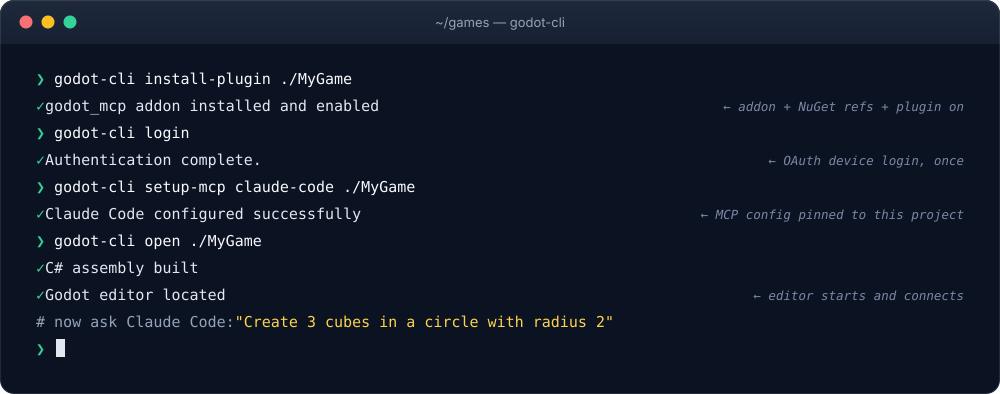

<div align="center">

<p></p>

[](https://www.npmjs.com/package/godot-cli) [](https://nodejs.org/) [](https://github.com/IvanMurzak/Godot-MCP/blob/main/LICENSE) [](https://discord.gg/cfbdMZX99G) [](https://stand-with-ukraine.pp.ua)

[English](../README.md) · [中文](README.zh-CN.md) · [日本語](README.ja.md) · [Español](README.es.md) · [فارسی](README.fa.md) · [हिन्दी](README.hi.md) · **العربية**

</div>

<div dir="rtl">

‏ **`godot-cli`** هو سطر الأوامر لـ [Godot-MCP](https://github.com/IvanMurzak/Godot-MCP)، إضافة محرر Godot التي تربط وكلاء الذكاء الاصطناعي (Claude Code وCursor وCodex وGitHub Copilot وغيرها) بمحرر Godot عبر [Model Context Protocol](https://modelcontextprotocol.io/). وهو نظير [`unity-mcp-cli`](https://www.npmjs.com/package/unity-mcp-cli) و[`unreal-mcp-cli`](https://www.npmjs.com/package/unreal-mcp-cli)، ويستند إلى [ai-game.dev](https://ai-game.dev).

</div>

<p align="center"></p>

<div dir="rtl">

<a id="features"></a>
## الميزات

‏✅ ‏**تثبيت بأمر واحد** — `install-plugin` يضيف الإضافة ومراجع NuGet ويفعّلها\
‏✅ ‏**تسجيل دخول مرة واحدة** — `login` يستخدم تدفق جهاز OAuth؛ ويلتقط المحرر بيانات الاعتماد\
‏✅ ‏**إعداد الوكيل** — `setup-mcp` يكتب إعدادات MCP لـ Claude Code وCursor وCodex وغيرها\
‏✅ ‏**التحكم في المحرر** — `open` و`close` و`status` و`wait-for-ready` لمحرر المشروع\
‏✅ ‏**تشغيل الأدوات** — `rql` و`exec` و`run-tool` تشغّل محررًا بلا واجهة عند عدم وجود محرر\
‏✅ ‏**CI بلا واجهة** — `check` و`import` و`test` و`export` و`run-script` دون محرر مفتوح\
‏✅ ‏**الامتدادات** — `install-extension` يضيف وحدات RQL اختيارية؛ و`update` يحدّث كل شيء

<a id="quick-start"></a>
## البدء السريع

يتطلب [Node.js](https://nodejs.org/) 22.14 أو أحدث، ومحرر Godot 4.3+ بإصدار .NET مع .NET 8 SDK. يعمل على Windows وmacOS وLinux.

</div>

```bash
npm install -g godot-cli

godot-cli install-plugin ./MyGodotProject          # addon + NuGet references + enable the plugin
godot-cli login                                    # sign in to ai-game.dev, once per machine
godot-cli setup-mcp claude-code ./MyGodotProject   # write the agent's MCP config
godot-cli open ./MyGodotProject                    # build C#, start the editor, connect
godot-cli wait-for-ready ./MyGodotProject          # wait until the plugin answers
```

<div dir="rtl">

شغّل C# أو RQL في المحرر من مجلد المشروع؛ ويبدأ محرر بلا واجهة (headless) إذا لم يكن أي محرر مفتوحًا:

</div>

```bash
godot-cli exec 'EditorInterface.Singleton.GetEditedSceneRoot()?.Name'
godot-cli rql 'nodes | where name starts-with "Tree" | count'
```

<div dir="rtl">

أو شغّل أي أمر دون تثبيت: `npx godot-cli install-plugin ./MyGodotProject`.

<a id="commands"></a>
## الأوامر

- ‏ **`open [path]`** — يبني تجميعة C# للمشروع (لكي تُحمَّل الإضافة عند أول فتح — انظر أدناه)، ويحدد الملف التنفيذي لمحرر Godot، ويشغّل `--editor --path <project>` مع متغيرات بيئة الاتصال `GODOT_MCP_*`. يتخطّى `--no-build` البناء. ويبدأ `--headless` بدلًا من ذلك جلسة محرر بلا نافذة (انظر [`exec`](#exec)).
- ‏ **`exec [code]`** — يشغّل C# في المحرر عبر `script-execute` (انظر [`exec`](#exec)): يعيد استخدام محرر قيد التشغيل، وإلا فيبدأ محررًا بلا واجهة ويبقيه جاهزًا.
- ‏ **`create-project [path]`** — ينشئ هيكل مشروع Godot جديد؛ ويكتب `--dotnet` أيضًا ملف `.csproj` بـ Godot.NET.Sdk، ويحدد `--name` اسمه.
- ‏ **`build [path]`** — يبني تجميعة C# للمشروع (`dotnet build`) لكي تُحمَّل الإضافة `godot_mcp` عند فتح المحرر التالي. في مشاريع GDScript فقط (بلا `.csproj`) لا يفعل شيئًا. وهو البناء نفسه الذي يجريه `open` قبل التشغيل.
- ‏ **`rql [query]`** — استعلام RQL واحد من سطر الأوامر، بلا JSON: `godot-cli rql 'nodes | where name starts-with "Tree" | count'`. الاستعلام الذي تكون مرحلته الأخيرة `set` أو `call` يذهب إلى `rql-mutate` (`--dry-run`، `--max-targets <n>`)، وأي استعلام آخر إلى `rql-query`؛ ويشغّل `--schema [type]` الأداة `rql-schema`؛ ويقرأ `-f <file>` (`-f -`: stdin) الاستعلام عندما تحذف الصدفة علامات الاقتباس. يبدأ محررًا بلا واجهة مثل `run-tool`. بعد `SaveScene()` أو `NewScene(...)` أو `CreateResource(...)` أو تعديل `godot.resource(...)` يطبع الملفات المكتوبة (`Saved to disk: res://scenes/forest.tscn`)؛ والعامل المكتوب بتهجئة لغة أخرى (`startsWith`، `like`) يحصل على تلميح بتهجئة RQL. يسرد `rql --help` وصفات جاهزة.
- ‏ **`run-tool <tool> [path]`** — يرسل POST إلى `<url>/api/tools/<tool>` بمدخلات JSON. في الوضع النصي يطبع الإجابة النصية كنصها (`--raw`: JSON الاستجابة؛ `--verbose`: ونقطة النهاية أيضًا). عندما لا يستجيب أي محرر على الخادم المحلي للمشروع يبدأ محررًا بلا واجهة مثل `exec` (`--no-start` يعطّل ذلك؛ و`--once` يغلقه بعد الاستدعاء).
- ‏ **`run-system-tool <tool> [path]`** — يرسل POST إلى `<url>/api/system-tools/<tool>` (أدوات غير معروضة لعملاء MCP). البدء التلقائي نفسه كما في `run-tool`.
- ‏ **`check [path]`** — بوابة CI دون محرر قيد التشغيل: استيراد، و`dotnet build`، وإقلاع المحرر، وفحص تحميل GDScript، والحكم من السجلات (انظر [الأوامر بلا واجهة](#headless-commands-check-import-test-export-run-script)).
- ‏ **`import [path]`** — `godot --headless --import`، ويفشل عند وجود أخطاء استيراد أو أخطاء سكربت في السجل.
- ‏ **`test [path]`** — يشغّل اختبارات GUT أو gdUnit4 للمشروع بلا واجهة مع مهلة صارمة؛ والحكم من تقرير JUnit والسجل.
- ‏ **`export <preset> <output>`** — يصدّر إعدادًا مسبقًا بلا واجهة (`--debug`، `--pack`)؛ ويتحقق من قوالب التصدير أولًا ومن المخرجات بعد ذلك.
- ‏ **`run-script <script> [args...]`** — يشغّل سكربت GDScript لمرة واحدة من نوع `SceneTree` (`godot --headless -s`)؛ ويخرج بـ 0 فقط بعد `quit(0)`.
- ‏ **`commands`** — بيان قابل للقراءة آليًا لكل أمر ووسائطه وخياراته ورموز الخروج (`--format json`).
- ‏ **`tools [name]`** — أدوات الذكاء الاصطناعي في المحرر (MCP `tools/list`؛ يبدأ محررًا بلا واجهة إذا لم يستجب أي محرر، ويخزّن القائمة مؤقتًا في `.ai-game-dev/tools.json`، المستثنى من git). مع اسم: وصف الأداة ووسائطها ومثال لاستدعاء `run-tool`. يسأل `--refresh` المحرر مجددًا؛ ويستخدم `--no-start` الذاكرة المؤقتة أو القائمة المدمجة.
- ‏ **`status [path]`** — يكتشف محرر Godot قيد التشغيل للمشروع ويفحص سلامة خادم MCP.
- ‏ **`wait-for-ready [path]`** — يستطلع خادم MCP حتى يستجيب لـ `ping`.
- ‏ **`login [path]`** — يصادق مع سحابة ai-game.dev عبر تدفق تفويض الجهاز في OAuth 2.1 (RFC 8628) — يفتح متصفحًا، ثم يحفظ بيانات اعتماد سحابية في مخزن الجهاز المشترك (`~/.ai-game-dev/credentials.json`) الذي يتبنّاه المكوّن الإضافي للمحرر تلقائيًا. انظر قسم `login` أدناه لخياراته `--project` / `--base-url` / `--force` / `--tools-only` / `--yes`.
- ‏ **`setup-mcp <agent> [path]`** — يكتب إعدادات عميل MCP للوكيل مشيرةً إلى عنوان URL المثبّت على المشروع `<host>/mcp/p/<pin>` (فيتوجّه الوكيل إلى محرر *هذا* المشروع). في وضع Cloud تحمل الإعدادات مفتاح هذا المشروع (`Authorization: Bearer agd_pk_…`). أضِف `--no-pin` لعنوان `<host>/mcp` المجرّد، و`--oauth` لإعدادات تقتصر على URL، و`--regenerate-key` لاستبدال المفتاح.
- ‏ **`setup-skills <agent> [path]`** — يكتب مهارة الوكيل `godot-cli` (سير عمل البدء من الصفر، وصفات RQL، رموز الخروج) و`ai-game-dev-app` في مسار مهارات الوكيل، دون اتصال. يعرض `--list` دعم المهارات لدى كل وكيل.
- ‏ **`configure [path]`** — يسرد / يُظهر / يُخفي الأدوات والموجّهات والموارد في الملف المحلي للمشروع `.godot-mcp/features.json` (`--enable-*` يُظهر، و`--disable-*` يُخفي؛ والأداة المخفية تعمل مع ذلك عند استدعائها باسمها).
- ‏ **`close [path]`** — يوقف بلطف محرر Godot العامل لمشروع ما (`--force` للإنهاء القسري). ويوقف أيضًا خادم MCP المحلي الذي شغّله ذلك المحرر إذا بقي بعده. يغلق `--owned-only` فقط محررًا بدأه `godot-cli` (`exec` / `open --headless`).
- ‏ **`install-plugin [path]`** — يثبّت الإضافة `godot_mcp` من البداية إلى النهاية: ينشئ `res://addons/godot_mcp/` (بتنزيل إصدار GitHub المطابق، أو نسخة محلية عبر `--source <path>`)، ويضيف إلى ملف `.csproj` للمشروع عناصر `PackageReference` الخاصة بـ NuGet التي تحتاجها الإضافة المثبّتة + عنصر `<EmbeddedResource>` لفهرس الامتدادات، ويفعّل المكوّن الإضافي. متساوي القوة (idempotent).
- ‏ **`install-extension <id> [path]`** — يثبّت **امتدادًا** لـ Godot-MCP (حزمة وحدة RQL اختيارية) في المشروع: يحلّ `<id>` من الفهرس المشترك، ويضيف/يحدّث `<PackageReference>` الخاص به في ملف `.csproj` للمشروع، ثم يعيد البناء للاستعادة. متساوي القوة — ومطابق سلوكيًا للوحة داخل المحرر.
- ‏ **`remove-plugin [path]`** — يعطّل الإضافة `godot_mcp` في `project.godot` ضمن `[editor_plugins]` (ولا يحذف ملفات الإضافة).
- ‏ **`update [path]`** — يحدّث كل شيء: الإضافة `godot_mcp` للمشروع والامتدادات المثبّتة إلى أحدث إصداراتها، ثم `godot-cli` نفسه. خارج أي مشروع يحدّث CLI فقط. يُبلغ `--check` (ويخرج بـ 2 إذا كان شيء ما قديمًا)؛ ويتخطّى `--no-self` و`--no-project` و`--no-extensions` خطوةً ما.

<a id="build-before-open-open--build"></a>
### البناء قبل الفتح (`open` / `build`)

يقوم `open` **ببناء تجميعة C# للمشروع قبل تشغيل المحرر**. ينشئ Godot كائن `EditorPlugin` للإضافة المفعّلة بمجرد تحميل المحرر — لذا عند أول فتح *جديد* لمشروع C# لم يُبنَ قط، لا توجد أي تجميعة بعد ويفشل Godot مع `Unable to load addon script 'res://addons/godot_mcp/Editor/GodotMcpPlugin.cs' … Disabling the addon`. البناء أولًا يضمن وجود التجميعة عند إنشاء الإضافة.

- البناء هو نفسه الذي يجريه `godot-cli build`: `dotnet build <project>.csproj --configuration Debug`.
- **مشاريع GDScript فقط** (بلا `.csproj` في الجذر) تُتخطّى تلقائيًا — فلا شيء لترجمته.
- يجري البناء **دون شرط** لمشاريع C#؛ و`dotnet build` تزايدي، فالمشروع المحدَّث لا يكلّف شيئًا يُذكر. مرّر `--no-build` إلى `open` لتخطّيه (مثلًا إذا بنيت مسبقًا، أو أردت الفتح بأسرع ما يمكن).
- إذا **فشل** البناء، **لا** يشغّل `open` المحرر (فالتشغيل سيعيد إنتاج فشل تعطيل الإضافة فقط)؛ ويُعرض الخطأ بدلًا من ذلك.

<a id="editor-resolution-open"></a>
### تحديد المحرر (`open`)

يحدد `open` الملف التنفيذي لمحرر Godot بهذا الترتيب:

1. ‏`--editor-path <path>` (صراحةً).
2. متغيرا البيئة `GODOT_BIN` / `GODOT4_BIN`.
3. أول ملف Godot تنفيذي مطابق في `PATH` (يُفضَّل إصدار mono على Windows).
4. مجلدات التثبيت الشائعة لكل نظام — يفضّل Windows إصدار mono؛ ويحدد macOS الملف التنفيذي `.app/Contents/MacOS/Godot`؛ ويفحص Linux المواقع الشائعة للملفات التنفيذية المستخرجة.

<a id="connection-env-vars"></a>
### متغيرات بيئة الاتصال

يمرّر `open` هذه المتغيرات إلى عملية المحرر (تطابق الأسماء `GodotMcpConfig` في الإضافة):

| الخيار | متغير البيئة |
| --- | --- |
| `--url <host>` | `GODOT_MCP_HOST` |
| `--cloud-url <url>` | `GODOT_MCP_CLOUD_URL` |
| `--token <token>` | `GODOT_MCP_TOKEN` |
| `--auth None\|Required` | `GODOT_MCP_AUTH_OPTION` |
| `--mode Cloud\|Custom` | `GODOT_MCP_CONNECTION_MODE` |
| `--log-level <level>` | `GODOT_MCP_LOG_LEVEL` |

الوضع الافتراضي للإضافة هو Cloud (ai-game.dev): لا يحتاج إلى منافذ مفتوحة، ويتجنب تعارض المنافذ مع البرامج الأخرى، وهو مجاني. لخادم محلي يتطلب رمزًا تختاره بنفسك (للعمل دون اتصال أو في بيئة معزولة)، افتح المحرر في وضع Custom بهذا الرمز، ثم اضغط **Start Server** في اللوحة (يختار `Required` التفويض `token`):

</div>

```bash
godot-cli open ./MyGodotProject --mode Custom --auth Required --token <token>
```

<div dir="rtl">

<a id="server-url-resolution-run-tool--status--wait-for-ready"></a>
### تحديد عنوان الخادم (`run-tool` / `status` / `wait-for-ready`)

يُحدَّد عنوان URL الأساسي للخادم الذي يُرسَل إليه استدعاء الأداة عبر POST (`<base>/api/tools/<name>`، أو `<base>/api/system-tools/<name>` لأدوات النظام — يفحص `status` / `wait-for-ready` أداة النظام `ping`) كما يلي:

1. ‏`--url <url>` (تجاوز صريح).
2. متغير البيئة `GODOT_MCP_HOST` (مضيف وضع Custom).
3. متغير البيئة `GODOT_MCP_CLOUD_URL` ← عنوان **مركز `/mcp`** السحابي (تُلحق `/mcp` إن لم تكن موجودة).
4. ‏`GODOT_MCP_CONNECTION_MODE=Cloud` ← المركز السحابي الافتراضي `https://ai-game.dev/mcp`.
5. **علامة المشروع المسجَّل** (`serverTarget` في `.ai-game-dev/project.json`، يكتبها `install-plugin --enroll`): الهدف المستضاف يُوجَّه إلى مركز `/mcp` الخاص به، وهدف `localhost` يُستخدم كما هو. وهذا يجعل **المشروع السحابي المسجَّل قابلًا للوصول دون أي إعداد للبيئة** — إذ تُستخدم بيانات الاعتماد السحابية المحفوظة (مخزن المشروع `<project>/.ai-game-dev/`، ثم المخزن القديم للمشروع، ثم `~/.ai-game-dev/credentials.json`) تلقائيًا، وتُجدَّد عند انتهاء صلاحيتها.
6. الاحتياطي المحلي: `http://localhost:<derived-port>`، وهو منفذ الإصدار v2 الحتمي المشتق من مسار المشروع الذي تربطه إضافة المحرر محليًا (قيمة `portOverride` في العلامة تتغلب على المنفذ المشتق من التجزئة).

تحمل المسارات السحابية مقطع المركز `/mcp` حتى يصل الطلب إلى المركز لا إلى الواجهة الخلفية السحابية (التي لا تخدم `/api/tools/*`). مرّر `--url http://localhost:<port>` لاستهداف خادم محلي/مستضاف ذاتيًا صراحةً.

تستبدل `run-tool` و`run-system-tool` و`exec` الخطوة 6 بـ **وضع اتصال المشروع**، مقروءًا بالطريقة التي تقرأه بها الإضافة (`GODOT_MCP_CONNECTION_MODE`، ملف `.env` للمشروع، الملف المحفوظ `user://godot-mcp-config.json`، وإلا Cloud، وهو الافتراضي في الإضافة). يستخدم وضع Custom الخادم المحلي المذكور أعلاه. ويستخدم وضع Cloud المركز السحابي مع تسجيل دخول الجهاز (لا يُبدأ أي محرر: فلا يستجيب إلا محرر متصل بـ ai-game.dev). إذا لم يسجّل هذا الجهاز الدخول إلى ai-game.dev **قط**، يُستخدم الخادم المحلي للمشروع بدلًا من ذلك، مع تحذير (يخدمه محرر يُبدأ الآن؛ ولا يُحفظ شيء). أما تسجيل الدخول الموجود الذي لا يمكن استخدامه (منتهي الصلاحية، أو ملغى، أو غير مقروء) فهو خطأ (الخروج 6، `NOT_AUTHENTICATED`): فالجهاز المسجَّل دخوله لا يُحوَّل أبدًا إلى خادم محلي. ويسري الأمر نفسه على `open` و`tools` و`open --headless`: في مشروع Cloud على جهاز مسجَّل دخوله لا يبدأ `open --headless` أي محرر ويخرج بـ 6 (استخدم `open` و`run-tool` و`exec`، التي تمر عبر ai-game.dev). يُستخدم `--url` / `--token` الصريح كما هو؛ وعنوان `--url` / `GODOT_MCP_HOST` غير المحلي يستدعيه `exec` مباشرةً ويرفضه `open --headless` (فالمحرر بلا واجهة محلي).


<a id="exec"></a>
## `exec`

شغّل C# في محرر Godot الخاص بالمشروع (أداة الإضافة `script-execute`، المبنية على [Code-Exec](https://github.com/IvanMurzak/Code-Exec)):

</div>

```bash
godot-cli exec '1 + 2'                                   # → System.Int32: 3
godot-cli exec -f snippet.cs --using MyGame.Gameplay      # code from a file ("-" or a pipe: stdin)
godot-cli exec 'Helper.Twice(21)' --include helpers       # .cs files/folders under <project>/.ai-game-dev/snippets
```

<div dir="rtl">

الكود عبارات عادية؛ وآخر تعبير هو النتيجة. المخرجات هي القيمة (`Type: value`) و، تحت `logs:`، ما طبعه الكود (`Console`؛ و`GD.Print` / push_warning / push_error مع Godot.NET.Sdk 4.5+). خطأ الترجمة يشير إلى سطر المقتطف (`snippet.cs(2,12)`) ويخرج بـ 6.

- **محرر قيد التشغيل للمشروع** (محررك، بنافذة، أو محرر بدأه `godot-cli`) يُعاد استخدامه ولا يُغلق أبدًا. ويجب أن يخدم محررك الخادم **المحلي** للمشروع (اللوحة: وضع Custom، والخادم قيد التشغيل).
- **لا محرر قيد التشغيل:** تُبنى تجميعة C#، ثم يبدأ محرر **بلا واجهة** (`--headless --editor --path`، أو بنافذة مع `--window`) متصلًا بالخادم المحلي للمشروع (`http://localhost:<derived port>`، أو `--url`)، الذي يبدؤه مكوّنه الإضافي بنفسه. يُغلق المحرر بلا واجهة بعد `--idle <seconds>` (الافتراضي 300، و`0` = أبدًا) دون استدعاءات أدوات، مع حفظ المشاهد المفتوحة التي لها ملف (أما المحرر ذو النافذة فيبقى مفتوحًا). الاستدعاءات المتوازية تبني مرة واحدة وتبدأ محررًا واحدًا؛ ومحرر المستخدم الذي لا يستجيب خادمه المحلي يُنتظر حتى 60 ثانية، ثم يُبلَّغ عنه.
- يبدأ `open --headless [--idle-timeout <s>]` الجلسة نفسها دون تشغيل كود؛ ويحفظها `close --owned-only` ويغلقها (عبر أداة المكوّن الإضافي `session-close` — ولا يمسّ محرر المستخدم أبدًا).

تستخدم الجلسات `EditorSession` من [`@baizor/gamedev-cli-core`](https://www.npmjs.com/package/@baizor/gamedev-cli-core): عقد الإيجار `<project>/.ai-game-dev/session.json` يعلّم المحرر بأنه بدأه CLI (ولا يُغلق إلا مثل هذا المحرر) ويسجّل الخادم الذي يعمل عليه: ما دام ذلك المحرر حيًا بشكل مثبت، تستخدم استدعاءات `exec` / `open` / `close` اللاحقة ذلك الخادم، أيًّا كانت قيمة `--url`. ويجعل `<project>/.ai-game-dev/session.lock` الاستدعاءات المتزامنة تبدأ محررًا واحدًا: يجري بناء C# تحت هذا القفل، وفقط في الاستدعاء الذي يبدأ المحرر. كلا الملفين مدرج في `<project>/.ai-game-dev/.gitignore`. يتلقى المحرر `AIGD_SESSION_IDLE_SECONDS` و`AIGD_SESSION_OWNER=cli` و`AIGD_SESSION_NONCE`، إضافةً إلى `GODOT_MCP_CONNECTION_MODE=Custom` و`GODOT_MCP_HOST` و`GODOT_MCP_START_SERVER=true`. الخيارات: `--ready-timeout <ms>`، و`--timeout <ms>` (استدعاء الأداة، الافتراضي 310000: أكثر بقليل من `tool-timeout` في الخادم البالغ 5 دقائق)، و`--no-build`، و`--editor-path`، و`--token`، و`--raw`.

يتبع `run-tool` / `run-system-tool` السياسة نفسها عندما يُرفض الاستدعاء على عنوان URL **محلي** لمشروع Godot: يبدآن محررًا بلا واجهة (مع بناء C# أولًا ما لم يُمرَّر `--no-build`)، ثم يعيدان المحاولة. المحرر قيد التشغيل يُعاد استخدامه ولا يُغلق أبدًا؛ ويغلق `--once` المحرر بعد ذلك فقط إذا كان هذا الاستدعاء هو من بدأه. يعطّل `--no-start` ذلك، وعنوان URL السحابي أو البعيد لا يبدأ أي شيء أبدًا. الخيارات: `--editor-path`، `--ready-timeout <ms>`.

<a id="exit-codes-and-output-formats"></a>
## رموز الخروج وصيغ المخرجات

رموز الخروج مشتركة مع `unity-mcp-cli` و`unreal-mcp-cli` (ويسردها `godot-cli commands --format json`):

| الرمز | المعنى |
| --- | --- |
| 0 | نجاح |
| 1 | خطأ عام أو غير مصنّف؛ وكذلك تشغيل قُطع بـ Ctrl+C / SIGTERM (تُنهى شجرة عمليات Godot) |
| 2 | خطأ استخدام: أمر أو خيار غير معروف، قيمة خيار أو وسيط غير صالحة، أداة غير معروفة (`NOT_FOUND`) (`--help` / `--version` يخرجان بـ 0) |
| 6 | الأمر نُفّذ وفشل: أعادت الأداة خطأً، أخطاء سكربت أو ترجمة، لا حكم للاختبارات، بيانات اعتماد مرفوضة |
| 7 | تعذّر الوصول إلى المحرر أو خادم MCP (وكذلك HTTP 502) |
| 8 | نُفّذت الاختبارات وفشل واحد منها على الأقل (يُحتسب فشل setup/teardown على مستوى المجموعة) |
| 14 | انتهاء المهلة (وكذلك HTTP 408 / 504) |
| 17 | الخادم مشغول (HTTP 503 / 429)؛ لم يُنفَّذ الاستدعاء |
| 18 | المحرر محجوب بنافذة حوار modal (محجوز: لا يمكن اكتشافه في Godot بلا واجهة) |

يظل `update --check` يخرج بـ 2 عندما يكون شيء ما قديمًا.

**استدعاء الأداة الذي لم ينجح** (`run-tool`، `run-system-tool`، `exec`، `rql`، `tools`) يُقابَل برمز الخروج ورمز الخطأ نفسيهما في الأدوات الثلاث (الجدول موجود في `@baizor/gamedev-cli-core`؛ ويسرده `commands --format json` باسم `errorCodes`). عندما يستجيب خادم MCP، تحسم حالة HTTP الخاصة به، ويحملها خطأ الغلاف: `errors[{code, message, httpStatus}]`.

| الحالة | حالة HTTP | الخروج | `errors[].code` |
|---|---|---|---|
| وسائط غير صالحة: خيار غير صالح، أو وسائط أداة رفضها CLI أو الخادم (أي 4xx غير مدرجة هنا) | 400 (و422 `[invalid_params]`) | `2` | `USAGE` |
| لا أداة بهذا الاسم (اسردها بـ `tools`)، أو لا مشروع في المسار | 404 | `2` | `NOT_FOUND` |
| لا بيانات اعتماد صالحة للاستخدام، أو رفضها الخادم: سجّل الدخول بـ `login` | 401, 403 | `6` | `NOT_AUTHENTICATED` |
| نُفّذت الأداة وأبلغت عن خطأ (`status: "error"`، أي 5xx غير مدرجة هنا) | 409, 422, 500 | `6` | `TOOL_FAILED` |
| لم يُبنَ كود المشروع، فلم يُبدأ أي محرر | — | `6` | `COMPILATION_FAILED` |
| الاتصال مرفوض أو أُعيد ضبطه، لا مكوّن إضافي لمحرك متصل بالخادم، فُقد المكوّن الإضافي بعد إرسال الاستدعاء | 502 | `7` | `UNREACHABLE` |
| لا إجابة في الوقت المحدد: `--timeout`، أو مهلة الأداة الخاصة بالخادم | 408, 504 | `14` | `TIMEOUT` |
| مشغول ولم يُنفّذ الاستدعاء (إعادة تحميل، تحديد معدّل، استدعاء CLI آخر يحتجز المحرر)؛ أعد المحاولة لاحقًا | 503, 429 | `17` | `BUSY` |
| أي شيء آخر (أُلغي الاستدعاء، خطأ غير متوقع) | — | `1` | `ERROR` |

يقبل `--format text|json|ndjson` (الافتراضي `text`) كلٌّ من `run-tool` و`run-system-tool` و`exec` و`status` و`wait-for-ready` و`check` و`import` و`test` و`export` و`run-script` و`commands`. تطبع `json` غلافًا واحدًا بالضبط على stdout:

</div>

```json
{ "success": false, "command": "check", "data": { "...": "..." },
  "errors": [{ "code": "SCRIPT_ERRORS", "message": "res://player.gd:12: error: Expected expression." }],
  "warnings": [] }
```

<div dir="rtl">

تطبع `ndjson` الأحداث على stderr، كائن JSON واحد في كل سطر (`{"type":"progress","command":…,"message":…}`، وكل سطر آخر بصيغة `{"type":"log","command":…,"level":"info|error","message":…}`)، والغلاف سطرًا واحدًا على stdout. وفي كلتيهما تذهب السجلات ومؤشرات الانتظار والعناوين إلى stderr دون ألوان. رموز الأخطاء: `USAGE`، `TOOL_FAILED`، `UNREACHABLE`، `TIMEOUT`، `BUSY`، `AWAITING_INPUT`، `TESTS_FAILED`، `TEST_RUN_ERROR`، `COMPILATION_FAILED`، `SCRIPT_ERRORS`، `IMPORT_FAILED`، `PROJECT_OPEN`، `NOT_FOUND`، `EXPORT_FAILED`، `NOT_AUTHENTICATED`، `CLOUD_PROJECT`، `ERROR`. ويظل `--raw` يعمل كما من قبل.

<a id="headless-commands-check-import-test-export-run-script"></a>
## الأوامر بلا واجهة (`check`، `import`، `test`، `export`، `run-script`)

تشغّل هذه الأوامر Godot دون جلسة محرر ولا تحتاج إلى خادم MCP. رمز خروج Godot ليس حكمًا في الوضع بلا واجهة (فـ `--import` مع خطأ تحليل في GDScript، أو إضافة تفشل في التحميل، يخرج مع ذلك بـ 0)، لذا يحكم كل أمر على التشغيل من سجله (`SCRIPT ERROR`، `ERROR:`، `Parse Error`)، ومن علامة تثبت أن الخطوة نُفّذت، ومن الملفات التي يجب أن تُنتجها. تحصل كل عملية على `--timeout` صارم (تُنهى شجرة عمليات Godot كاملةً: الخروج 14). تذهب السجلات والسكربتات المؤقتة إلى `<project>/.godot/godot-cli/`. ترفض `check` و`import` و`test` و`export` المشروع المفتوح في محرر (الخروج 6، `PROJECT_OPEN`: فالاستيراد يتنازع مع ذلك المحرر على `.godot/`)؛ ويتجاوز `--allow-open` ذلك، ويوقف `close` محرر `godot-cli`. يأتي الملف التنفيذي من `--editor-path` أو `GODOT_BIN` أو `PATH` أو مجلدات التثبيت المعتادة.

</div>

```bash
godot-cli check                     # 0 clean, 6 SCRIPT_ERRORS / COMPILATION_FAILED, 14 timeout
godot-cli check --strict            # GDScript and C# compiler warnings fail too
godot-cli test --format github      # ::error annotations; 0 pass, 8 failures, 6 no verdict / no runner
godot-cli export "Windows Desktop" build/game.exe
godot-cli run-script tools/migrate.gd -- --dry-run
```

<div dir="rtl">

- ‏ **`check [path] [--strict] [--include-addons]`** يشغّل أربع عمليات منفصلة (فعملية `--build-solutions --quit` باردة واحدة تنهار مع مكوّنات C# الإضافية من نوع `[Tool]`): `--headless --import`؛ و`dotnet build` لمشروع C# (الأخطاء بصيغة `file(line,col): error CS…`)؛ و`--headless --editor --quit`، الذي يجب أن يطبع `[Godot-MCP] plugin loaded` عندما تكون الإضافة مفعّلة؛ وتمريرة GDScript تحمّل كل ملف `.gd` ضمن `res://` (و`res://addons/` فقط مع `--include-addons`) وتُبلغ عن أخطاء التحليل بصيغة `res://file:line`. يُفشل `--strict` الفحص أيضًا عند تحذيرات GDScript (تحذيرات المشروع من مستوى Warn تُرفع إلى أخطاء في الذاكرة، ولا تُحفظ أبدًا) وتحذيرات C# من نوع `CS`. رسائل المحرك (تحذيرات وقت التشغيل لمكوّن إضافي، مثلًا) تُدرج كتحذيرات ولا تُفشل الفحص أبدًا.
- ‏ **`import [path]`** يفشل عند أخطاء السكربتات (`SCRIPT_ERRORS`) وعند الموارد التي تفشل في الاستيراد (`IMPORT_FAILED`).
- ‏ **`test [path]`** يعثر على GUT (`addons/gut`) أو gdUnit4 (`addons/gdUnit4`)، ويستورد المشروع (يتخطّى `--no-import` ذلك)، ويشغّل سكربت سطر الأوامر للمشغّل مع تقرير JUnit (`-gjunit_xml_file`، أو `-rd` في gdUnit4؛ ويعمل gdUnit4 مع `--ignoreHeadlessMode -c`). الخروج 0 عند نجاح كل الاختبارات، و8 عند الإخفاقات، و6 (`TEST_RUN_ERROR`) عند غياب التقرير، أو عدم تشغيل أي اختبار، أو فشل تحميل سكربت اختبار (فاختباراته غائبة عن التقرير، لذا يجب ألا ينجح)، و6 (`NOT_FOUND`) مع تلميح للتثبيت عند عدم تثبيت أي مشغّل. `--runner gut|gdunit4`، `--dir <dir>` (قابل للتكرار؛ الافتراضي `res://test` أو `res://tests` أو `.gutconfig.json` الخاص بـ GUT)، `--filter <text>` (سكربتات الاختبار التي يحتوي اسم ملفها عليه)، `--output <file>` (نسخ ملف JUnit XML)، `--format text|json|ndjson|github`.
- ‏ **`export <preset> <output> [--debug|--pack]`** يتحقق من أن `export_presets.cfg` يحتوي الإعداد المسبق ومن تثبيت قوالب التصدير لإصدار المحرر (ما لم يُمرَّر `--pack` أو يسمِّ الإعداد المسبق قالبه الخاص)، ويشغّل `--export-release|--export-debug|--export-pack`، ويفشل (`EXPORT_FAILED`) ما لم يكن ملف المخرجات موجودًا وغير فارغ ومكتوبًا في هذا التشغيل، وما لم يخلُ السجل من أخطاء التصدير (يكتب Godot الملف التنفيذي ويخرج بـ 0 حتى عندما يفشل، مثلًا، نشر C# لغياب ملف `.sln`).
- ‏ **`run-script <script> [args...]`** يشغّل `godot --headless --path <project> -s <script> -- <args>`: يرث السكربت `SceneTree` أو `MainLoop` وينتهي بـ `quit(code)`. الخروج 0 لـ `quit(0)`؛ و6 لرمز آخر (`data.scriptExitCode`) أو لسكربت فشل في التحميل؛ و14 عند `--timeout` (الافتراضي 300000 مللي ثانية). لا يُجري استيرادًا، لذا يعمل أيضًا والمشروع مفتوح في محرر.

<a id="login"></a>
## `login`

يصادق `godot-cli login` اتصال **السحابة** للمكوّن الإضافي للمحرر مع [ai-game.dev](https://ai-game.dev) باستخدام **تدفق تفويض الجهاز في OAuth 2.1** (RFC 8628) — يطبع رمز مستخدم قصيرًا + عنوان URL للتحقق، ويفتح متصفحك، ويستطلع حتى توافق:

</div>

```bash
godot-cli login                       # sign in once per machine (default)
godot-cli login --project ./MyGame    # keep a per-project credential instead
godot-cli login --base-url <url>      # authenticate against a non-default server
godot-cli login --force               # re-authenticate over an existing credential
godot-cli login --tools-only         # CI/automation: tools credential only (no App pickup)
godot-cli login --yes                # non-interactive: confirm replacing another account's credential
```

<div dir="rtl">

- افتراضيًا تُحفظ بيانات الاعتماد في **مخزن الجهاز** المشترك `~/.ai-game-dev/credentials.json` (`0600` على POSIX / DPAPI على Windows) — سجّل الدخول **مرة واحدة لكل جهاز** فيتبنّاها المكوّن الإضافي لمحرر Godot تلقائيًا، فيتصل `godot-cli open --mode Cloud` **دون `--token`**.
- تسجيل الدخول الافتراضي يسجّل دخول الجهاز كله: يطلب التدفق منحةً **بنطاق الوكيل** (agent-scope) ويشتق منها **بيانات اعتماد الأدوات (المكوّن الإضافي)** الأضيق عبر تبادل الرموز RFC 8693، فتلتقط كل أداة من أدوات AI-Game-Dev على الجهاز (مكوّنات المحركات الإضافية، وأدوات CLI، وتطبيق سطح المكتب) تسجيلَ الدخول.
- يُصدر `--tools-only` بيانات اعتماد الأدوات **فقط** — لا يُخزَّن أي شيء بنطاق الوكيل، ولا يستطيع تطبيق سطح المكتب تبنّي تسجيل الدخول، ويظهر المشغّل كجهاز مستقل قابل للإلغاء على [ai-game.dev](https://ai-game.dev). استخدمه لـ CI ومشغّلات الأتمتة المشتركة.
- إذا كان الجهاز يحمل بالفعل بيانات اعتماد **لحساب مختلف**، يسأل تسجيل الدخول قبل استبدالها (الرفض يلغي بيانات الاعتماد المُصدرة للتو ويترك المخزن دون مساس). مرّر `--yes` للتأكيد بشكل غير تفاعلي.
- يحتفظ `--project <path>` (أو الوسيط الموضعي `[path]`) ببيانات اعتماد لكل مشروع (`<path>/.ai-game-dev/credentials.json`، مستثنى من git) للحسابات الخاصة بكل مشروع. المخزن القديم لكل مشروع `<path>/.godot-mcp/credentials.json` **لم يعد يُكتب** — ولا يزال يُقرأ (ويُرحَّل إلى مخزن الجهاز عند أول استخدام) لإصدار واحد.
- يحفظ التدفق مجموعة بيانات الاعتماد **كاملة** (رمز الوصول + رمز التحديث الدوّار + وقت الانتهاء) — **ولا يُصدر أبدًا رمز وصول شخصي (PAT)**. وعند أي فشل لا يُكتب شيء، فتنجو بيانات الاعتماد الموجودة سليمةً من الرفض أو انتهاء الصلاحية أو خطأ الشبكة. تجدّد الأوامر رمز الوصول المنتهي تلقائيًا (عبر `@baizor/gamedev-cli-core`)، فيبقى الجهاز المسجَّل دخوله مسجَّلًا دون إعادة تشغيل `login`.

<a id="setup-skills"></a>
## `setup-skills`

يولّد `godot-cli setup-skills <agent> [path]` **ملفات مهارات** لوكيل الذكاء الاصطناعي لمشروع Godot ضمن مسار مهارات الوكيل المختار (مثلًا `.claude/skills` في Claude Code). استخدم `--list` لرؤية كل وكيل ودعمه للمهارات.

</div>

```bash
godot-cli setup-skills claude-code            # generate into ./.claude/skills
godot-cli setup-skills cursor ./MyGame        # generate into MyGame/.cursor/skills
godot-cli setup-skills --list                 # list agents + their skills paths
```

<div dir="rtl">

يكتب، دون اتصال (بلا محرر، بلا خادم، بلا شبكة):

- ‏`godot-cli/SKILL.md`: كيف يستخدم الوكيل هذا CLI بدءًا من الصفر: أول أمر للمحرر يبدأ محررًا بلا واجهة، و`rql` مع وصفات للمشاهد والعقد والموارد، و`check` / `test`، و`--format json`، ومعنى كل رمز خروج. وهو قصير عن قصد (فالوكيل يحتفظ في سياقه بكل بايت يقرؤه)؛ ويحمل `references/rql.md` و`references/install.md` التفاصيل، ولا يُقرآن إلا عند الحاجة. تأتي الوصفات من المصدر نفسه الذي يأتي منه `godot-cli --help` و`rql --help`، فلا يمكن أن تتباعد المهارة والمساعدة.
- ‏`ai-game-dev-app/SKILL.md`: التطبيق المرافق، للأدوات الإبداعية غير الموجودة في CLI.

وهو **متساوي القوة**: إعادة التشغيل تكتب البايتات نفسها. ويزيل مهارات `godot-mcp` / `godot-mcp-<family>` التي ولّدتها الإصدارات السابقة من فهرس مكتوب يدويًا. أما المهارات الخاصة بكل أداة فهي من مهام الإضافة: فهي تولّدها من الأدوات التي تسجّلها فعلًا كلما عمل المحرر (مفتاح في لوحة Skills في الإضافة)، مع دليلها `godot-cli-install`.

<a id="install-plugin"></a>
## `install-plugin`

‏`godot-cli install-plugin [path]` **مثبّت حقيقي** — يجعل التثبيت من الصفر عبر الطرفية يُنتج مشروعًا يعمل، بأمر واحد متساوي القوة:

</div>

```bash
godot-cli install-plugin ./MyGodotProject                      # download the matching release + install
godot-cli install-plugin --version <x.y.z> ./MyGodotProject   # pin a specific addon release
godot-cli install-plugin --source ./Godot-MCP/addons/godot_mcp ./MyGodotProject   # offline / dev copy
```

<div dir="rtl">

ينفّذ أربع خطوات:

1. **إنشاء `res://addons/godot_mcp/`.** افتراضيًا ينزّل `godot-mcp-addon-<version>.zip` عبر HTTPS من **github.com فقط** (إصدار `IvanMurzak/Godot-MCP` ‏`v<version>`؛ والإصدار الافتراضي هو إصدار CLI نفسه). تُرفض المضيفات غير `github.com` و`http` العادي. ومع `--source <path>` ينسخ الإضافة من مجلد محلي بدلًا من ذلك (بلا شبكة) — ويمكن أن يكون `<path>` مجلدًا *هو* `addons/godot_mcp` أو مجلدًا *يحتويه*.
2. **إضافة حزم NuGet** التي تحتاجها الإضافة (`com.IvanMurzak.ReflectorNet`، `com.IvanMurzak.McpPlugin`) إلى ملف `.csproj` للمشروع، بشكل متساوي القوة — إضافةً عند الغياب، ومواءمةً للإصدار القديم، وتركًا للتثبيت الصحيح دون مساس. تأتي الإصدارات من الإضافة الجاري تثبيتها: ملف `nuget-deps.json` الخاص بها (يولّده سير عمل الإصدار من `Godot-MCP.csproj` في كل ملف zip للإصدار)، أو، مع `--source` المشير إلى نسخة Godot-MCP، ملف `Godot-MCP.csproj` لتلك النسخة. ملفات zip القديمة للإضافة التي تخلو من البيان تعود إلى الإصدارات المدمجة في CLI، مع تحذير.
3. **تضمين فهرس الامتدادات** (`<EmbeddedResource Include="addons/godot_mcp/extensions.catalog.json" LogicalName="Godot-MCP.extensions.catalog.json" />`) في ملف `.csproj` للمشروع، بشكل متساوي القوة. بدونه لا يقرأ سجل الامتدادات في الإضافة أي فهرس أثناء تشغيل المحرر وتكون **لوحة Extensions فارغة**. مصدره واحد + مختبر للتكافؤ مع csproj الإضافة إلى جانب الإصدارات المثبّتة. ويضبط أيضًا `<EnableDynamicLoading>true</EnableDynamicLoading>` (قالب Godot يتضمنه؛ وبدونه لا تستطيع لعبة مُشغَّلة من المحرر إنشاء سكربتات C#).
4. **تفعيل المكوّن الإضافي** في `project.godot` ضمن `[editor_plugins]`.

وهو آمن للاستخدام كمكتبة (يُعيد اتحادًا `{ kind: 'success' | 'failure' }`؛ ولا يرمي استثناءً أبدًا خارج الحد العام) ومتساوي القوة — إعادة تشغيله على مشروع مثبّت مسبقًا تُبلغ بعدم وجود تغيير.

<a id="install-extension"></a>
## `install-extension`

يثبّت `godot-cli install-extension <id> [path]` **امتدادًا** اختياريًا لـ Godot-MCP (حزمة NuGet اختيارية توسّع RQL؛ ولا تضيف أدوات خاصة بها) في مشروع Godot بـ C# — وهو قناة الطرفية/المكتبة للتثبيت نفسه الذي تجريه لوحة **Extensions** داخل المحرر:

</div>

```bash
godot-cli install-extension com.IvanMurzak.Godot.MCP.CSG ./MyGodotProject   # add/update the PackageReference
godot-cli install-extension "CSG Tools"                                      # resolve by name; default cwd
godot-cli install-extension com.IvanMurzak.Godot.MCP.CSG --version <x.y.z>   # override the catalog pin
```

<div dir="rtl">

- يحلّ `<id>` مقابل **فهرس الامتدادات المشترك** (`addons/godot_mcp/extensions.catalog.json` — المصدر الوحيد للحقيقة الذي تستهلكه اللوحة وCLI والتطبيق جميعًا)، مطابقًا بمعرّف الحزمة (ثم الاسم)، دون تمييز حالة الأحرف.
- يقرأ ويعدّل ويكتب `<PackageReference Include="<packageId>" Version="<version>" />` في ملف `.csproj` الجذري للمشروع: **يُضاف** عند غيابه، و**يُرفع** إصداره فقط عندما يثبّت الفهرس (أو `--version`) إصدارًا أحدث، و**لا يفعل شيئًا** عندما يكون محدَّثًا — ثم يطلب منك إعادة البناء (`godot-cli build`) ليستعيد Godot الحزمة الجديدة ويترجمها.
- مطابق سلوكيًا لـ `ExtensionInstaller` في اللوحة (قواعد الإضافة / التحديث / عدم التغيير نفسها + مقارنة الإصدارات الرقمية؛ ومُتحقَّق منه بمجموعة سيناريوهات مشتركة في الجانبين).

<a id="library-api"></a>
## واجهة المكتبة البرمجية

تصدّر الحزمة أيضًا مكتبة خالية من الآثار الجانبية (المدخل `.`):

</div>

```ts
import { openProject, runTool, setupMcp, installPlugin, installExtension, execCode, ensureEditor } from 'godot-cli';

// The shared extension catalog + lookup helpers are exported too, so a GUI (the app)
// can render the same list the dock + CLI install from:
import { EXTENSIONS_CATALOG, findExtension } from 'godot-cli';

// The headless commands, their log/JUnit parsers and the exit codes:
import { checkProject, importProject, runTests, exportProject, runScript, parseGodotLog, parseJUnit, ExitCode } from 'godot-cli';
```

<div dir="rtl">

تُعيد كل دالة اتحادًا مميَّزًا (`{ kind: 'success', ... }` / `{ kind: 'failure', error }`) ولا ترمي استثناءً أبدًا خارج الحد العام.

<a id="development"></a>
## التطوير

</div>

```bash
npm install
npm run build   # tsc → dist/ (ESM)
npm test        # vitest
```

<div dir="rtl">


<a id="supported-ai-agents"></a>
## وكلاء الذكاء الاصطناعي المدعومون

يكتب `godot-cli` إعدادات عميل MCP جاهزة للاستخدام لكل وكيل برمجة رئيسي بالذكاء الاصطناعي — شغّل `godot-cli setup-mcp <agent> [path]` لتوصيل أحدها (و`godot-cli setup-skills <agent> [path]` لتوليد ملفات مهاراته). استخدم `--list` مع أي من الأمرين لرؤية كل وكيل مدعوم.

تشمل الوكلاء المدعومة Claude Code وClaude Desktop وCursor وVS Code وVisual Studio (Copilot) وGitHub Copilot CLI وRider (Junie) وCodex وGemini وAntigravity وCline وOpen Code وKilo Code، وعميل MCP عامًا `custom`.

</div>

```bash
godot-cli setup-mcp --list                    # list every supported agent id
godot-cli setup-mcp claude-code ./MyGame      # write the agent's MCP client config (pinned to this project)
godot-cli setup-mcp claude-code ./MyGame --no-pin   # write the bare, unpinned <host>/mcp URL instead
godot-cli setup-mcp claude-code ./MyGame --oauth    # URL-only: the agent signs in with its own OAuth
godot-cli setup-mcp claude-code ./MyGame --regenerate-key   # new project key; the old one is revoked
```

<div dir="rtl">

في وضع Cloud يكتب `setup-mcp` **مفتاح مشروع** في إعدادات الوكيل لكل وكيل: `Authorization: Bearer agd_pk_…` (في Codex: `http_headers`). مفتاح المشروع لا تنتهي صلاحيته أبدًا، ومرتبط بتثبيت هذا المشروع (pin) (فلا يستطيع الوصول إلى أي مشروع آخر في حسابك)، ويُنشأ مرة واحدة لكل مشروع بتسجيل دخول جهازك (`godot-cli login`)، ثم يُعاد استخدامه من `~/.ai-game-dev/project-keys.json`. يستبدله `--regenerate-key` ويلغي القديم. بدون تسجيل دخول الجهاز (أو حين لا يستطيع الخادم إصدار المفاتيح) تقتصر الإعدادات على URL ويصادق الوكيل عبر OAuth الخاص به؛ ويطلب `--oauth` هذه الإعدادات المقتصرة على URL صراحةً. ويتغلب `--token` الصريح دائمًا. إعدادات الخادم المحلي (`--url http://localhost:…`) لا تحمل مفتاح مشروع أبدًا.

> للاطلاع على التوثيق الكامل لمشروع Godot-MCP، انظر [README الرئيسي](../../docs/README.ar.md). يستند إلى **[ai-game.dev](https://ai-game.dev)**.

</div>
