<div align="center">

<p></p>

[](https://www.npmjs.com/package/godot-cli) [](https://nodejs.org/) [](https://github.com/IvanMurzak/Godot-MCP/blob/main/LICENSE) [](https://discord.gg/cfbdMZX99G) [](https://stand-with-ukraine.pp.ua)

[English](../README.md) · [中文](README.zh-CN.md) · [日本語](README.ja.md) · [Español](README.es.md) · [فارسی](README.fa.md) · **हिन्दी** · [العربية](README.ar.md)

</div>

**`godot-cli`** [Godot-MCP](https://github.com/IvanMurzak/Godot-MCP) की command line है। Godot-MCP वह Godot editor addon है जो AI एजेंट्स (Claude Code, Cursor, Codex, GitHub Copilot, …) को [Model Context Protocol](https://modelcontextprotocol.io/) के ज़रिए Godot editor से जोड़ता है। यह [`unity-mcp-cli`](https://www.npmjs.com/package/unity-mcp-cli) और [`unreal-mcp-cli`](https://www.npmjs.com/package/unreal-mcp-cli) का भाई है, और [ai-game.dev](https://ai-game.dev) पर आधारित है।

<p align="center"></p>

<a id="features"></a>
## फ़ीचर्स

✅ **एक command में install** — `install-plugin` addon, NuGet references जोड़ता है और उसे enable करता है\
✅ **एक बार sign in** — `login` OAuth device flow इस्तेमाल करता है; editor credential खुद ले लेता है\
✅ **एजेंट setup** — `setup-mcp` Claude Code, Cursor, Codex वगैरह के लिए MCP config लिखता है\
✅ **Editor कंट्रोल** — प्रोजेक्ट के editor के लिए `open`, `close`, `status` और `wait-for-ready`\
✅ **Tools चलाएँ** — editor न चल रहा हो तो `rql`, `exec`, `run-tool` headless editor शुरू करते हैं\
✅ **Headless CI** — खुले editor के बिना `check`, `import`, `test`, `export` और `run-script`\
✅ **Extensions** — `install-extension` वैकल्पिक RQL modules जोड़ता है; `update` सब कुछ अपडेट करता है

<a id="quick-start"></a>
## क्विक स्टार्ट

[Node.js](https://nodejs.org/) 22.14 या नया, और .NET 8 SDK के साथ Godot 4.3+ .NET editor चाहिए। Windows, macOS और Linux पर काम करता है।

```bash
npm install -g godot-cli

godot-cli install-plugin ./MyGodotProject          # addon + NuGet references + plugin enable करना
godot-cli login                                    # ai-game.dev में sign in, हर मशीन पर एक बार
godot-cli setup-mcp claude-code ./MyGodotProject   # एजेंट का MCP config लिखें
godot-cli open ./MyGodotProject                    # C# build, editor शुरू, connect
godot-cli wait-for-ready ./MyGodotProject          # plugin के जवाब देने तक इंतज़ार
```

प्रोजेक्ट फ़ोल्डर से editor में C# या RQL चलाएँ; कोई editor खुला न हो तो headless editor शुरू हो जाता है:

```bash
godot-cli exec 'EditorInterface.Singleton.GetEditedSceneRoot()?.Name'
godot-cli rql 'nodes | where name starts-with "Tree" | count'
```

या बिना install किए कोई भी command चलाएँ: `npx godot-cli install-plugin ./MyGodotProject`।

<a id="commands"></a>
## Commands

- **`open [path]`** — प्रोजेक्ट की C# assembly build करता है (ताकि पहली बार खोलने पर addon load हो — नीचे देखें), Godot editor binary ढूँढता है, और `GODOT_MCP_*` connection env vars के साथ `--editor --path <project>` launch करता है। `--no-build` build छोड़ देता है। `--headless` इसकी जगह बिना window वाला editor session शुरू करता है ([`exec`](#exec) देखें)।
- **`exec [code]`** — `script-execute` के ज़रिए editor में C# चलाता है ([`exec`](#exec) देखें): चलते हुए editor को reuse करता है, नहीं तो एक headless editor शुरू करके उसे warm रखता है।
- **`create-project [path]`** — नया Godot प्रोजेक्ट scaffold करता है; `--dotnet` एक Godot.NET.Sdk `.csproj` भी लिखता है, `--name` उसका नाम सेट करता है।
- **`build [path]`** — प्रोजेक्ट की C# assembly build करता है (`dotnet build`) ताकि अगली बार editor खोलने पर `godot_mcp` addon load हो। सिर्फ़ GDScript वाले प्रोजेक्ट्स (`.csproj` नहीं) पर यह कुछ नहीं करता। यह वही build है जो `open` launch से पहले चलाता है।
- **`rql [query]`** — command line से एक RQL query, बिना JSON के: `godot-cli rql 'nodes | where name starts-with "Tree" | count'`। जिस query का आख़िरी stage `set` या `call` हो वह `rql-mutate` पर जाती है (`--dry-run`, `--max-targets <n>`), बाकी सब `rql-query` पर; `--schema [type]` `rql-schema` चलाता है; जब shell quotes हटा दे तो `-f <file>` (`-f -`: stdin) query पढ़ता है। `run-tool` की तरह headless editor शुरू करता है। `SaveScene()`, `NewScene(...)`, `CreateResource(...)` या `godot.resource(...)` edit के बाद यह लिखी गई files print करता है (`Saved to disk: res://scenes/forest.tscn`); किसी दूसरी language की spelling वाले operator (`startsWith`, `like`) पर RQL की spelling के साथ hint मिलता है। `rql --help` recipes दिखाता है।
- **`run-tool <tool> [path]`** — JSON input के साथ `<url>/api/tools/<tool>` पर POST करता है। Text mode में text जवाब उसके text के रूप में print होता है (`--raw`: response JSON; `--verbose`: endpoint भी)। जब प्रोजेक्ट के लोकल server पर कोई editor जवाब नहीं देता, तो यह `exec` की तरह headless editor शुरू करता है (`--no-start` इसे बंद करता है; `--once` call के बाद उसे बंद कर देता है)।
- **`run-system-tool <tool> [path]`** — `<url>/api/system-tools/<tool>` पर POST करता है (ऐसे tools जो MCP clients को expose नहीं होते)। `run-tool` जैसा ही auto-start।
- **`check [path]`** — चलते editor के बिना CI gate: import, `dotnet build`, editor boot और एक GDScript load check, logs के आधार पर फ़ैसला ([headless commands](#headless-commands-check-import-test-export-run-script) देखें)।
- **`import [path]`** — `godot --headless --import`, log में import और script errors होने पर fail।
- **`test [path]`** — प्रोजेक्ट के GUT या gdUnit4 tests hard timeout के साथ headless चलाता है; फ़ैसला JUnit report और log से।
- **`export <preset> <output>`** — किसी preset को headless export करता है (`--debug`, `--pack`); पहले export templates और बाद में output जाँचता है।
- **`run-script <script> [args...]`** — एक one-shot `SceneTree` GDScript चलाता है (`godot --headless -s`); exit 0 सिर्फ़ `quit(0)` के बाद।
- **`commands`** — हर command, उसके arguments और options, और exit codes का machine-readable manifest (`--format json`)।
- **`tools [name]`** — editor के AI tools (MCP `tools/list`; कोई जवाब न दे तो headless editor शुरू करता है, सूची को `.ai-game-dev/tools.json` में cache करता है, जो git-ignored है)। नाम देने पर: उसका description, arguments और एक उदाहरण `run-tool` call। `--refresh` editor से फिर पूछता है; `--no-start` cache या built-in सूची इस्तेमाल करता है।
- **`status [path]`** — प्रोजेक्ट के लिए चल रहा Godot editor detect करता है और MCP-server health probe करता है।
- **`wait-for-ready [path]`** — MCP server को तब तक poll करता है जब तक वह `ping` का जवाब न दे।
- **`login [path]`** — OAuth 2.1 device-authorization flow (RFC 8628) से ai-game.dev cloud में authenticate करता है — browser खोलता है, फिर cloud credential को shared machine store (`~/.ai-game-dev/credentials.json`) में save करता है, जिसे editor plugin अपने आप अपना लेता है। इसके `--project` / `--base-url` / `--force` / `--tools-only` / `--yes` flags के लिए नीचे `login` section देखें।
- **`setup-mcp <agent> [path]`** — एजेंट का MCP-client config लिखता है जो project-pinned `<host>/mcp/p/<pin>` URL की ओर इशारा करता है (ताकि एजेंट *इसी* प्रोजेक्ट के editor तक पहुँचे)। Cloud mode में config में इस प्रोजेक्ट की key होती है (`Authorization: Bearer agd_pk_…`)। Bare `<host>/mcp` URL के लिए `--no-pin`, सिर्फ़-URL config के लिए `--oauth`, key बदलने के लिए `--regenerate-key` जोड़ें।
- **`setup-skills <agent> [path]`** — `godot-cli` एजेंट skill (cold-start workflow, RQL recipes, exit codes) और `ai-game-dev-app` को एजेंट के skills path में offline लिखता है। `--list` हर एजेंट का skills support दिखाता है।
- **`configure [path]`** — project-local `.godot-mcp/features.json` में tools, prompts और resources की सूची / दिखाना / छिपाना (`--enable-*` दिखाता है, `--disable-*` छिपाता है; छिपा tool नाम से call होने पर फिर भी चलता है)।
- **`close [path]`** — प्रोजेक्ट के लिए चल रहे Godot editor को gracefully रोकता है (hard-kill के लिए `--force`)। उस editor द्वारा चलाया गया लोकल MCP server, अगर वह बचा रह गया हो, तो उसे भी रोकता है। `--owned-only` सिर्फ़ वही editor बंद करता है जो `godot-cli` ने शुरू किया हो (`exec` / `open --headless`)।
- **`install-plugin [path]`** — `godot_mcp` addon को शुरू से आख़िर तक install करता है: `res://addons/godot_mcp/` तैयार करता है (मेल खाती GitHub release download करके, या `--source <path>` से लोकल copy), install हुए addon को चाहिए NuGet `PackageReference`s + extension-catalog `<EmbeddedResource>` प्रोजेक्ट `.csproj` में जोड़ता है, और plugin enable करता है। Idempotent।
- **`install-extension <id> [path]`** — प्रोजेक्ट में एक Godot-MCP **extension** (एक वैकल्पिक RQL-module package) install करता है: shared catalog से `<id>` resolve करता है, प्रोजेक्ट `.csproj` में उसका `<PackageReference>` जोड़ता/अपडेट करता है, फिर restore के लिए rebuild करता है। Idempotent — व्यवहार में in-editor dock के बिल्कुल समान।
- **`remove-plugin [path]`** — `project.godot` `[editor_plugins]` में `godot_mcp` addon को disable करता है (addon files delete नहीं करता)।
- **`update [path]`** — सब कुछ अपडेट करता है: प्रोजेक्ट का `godot_mcp` addon और install हुए extensions उनके latest versions पर, फिर खुद `godot-cli`। प्रोजेक्ट के बाहर यह सिर्फ़ CLI अपडेट करता है। `--check` रिपोर्ट देता है (कुछ पुराना हो तो exit 2); `--no-self`, `--no-project`, `--no-extensions` एक step छोड़ देते हैं।

<a id="build-before-open-open--build"></a>
### खोलने से पहले build (`open` / `build`)

`open` **editor launch करने से पहले प्रोजेक्ट की C# assembly build करता है**। Editor load होते ही Godot enabled addon का `EditorPlugin` instantiate कर देता है — इसलिए ऐसे C# प्रोजेक्ट को *पहली बार* खोलने पर जो कभी build नहीं हुआ, assembly अभी मौजूद नहीं होती और Godot `Unable to load addon script 'res://addons/godot_mcp/Editor/GodotMcpPlugin.cs' … Disabling the addon` के साथ fail हो जाता है। पहले build करने से यह पक्का होता है कि addon instantiate होते समय assembly मौजूद है।

- Build वही है जो `godot-cli build` चलाता है: `dotnet build <project>.csproj --configuration Debug`।
- **सिर्फ़ GDScript वाले प्रोजेक्ट्स** (root पर `.csproj` नहीं) अपने आप skip हो जाते हैं — compile करने को कुछ नहीं है।
- C# प्रोजेक्ट्स के लिए build **हमेशा** चलता है; `dotnet build` incremental है, इसलिए up-to-date प्रोजेक्ट पर यह तेज़ no-op है। इसे skip करने के लिए `open` को `--no-build` दें (जैसे आपने पहले ही build कर लिया है, या जितनी जल्दी हो सके खोलना चाहते हैं)।
- अगर build **fail** होता है, तो `open` editor launch **नहीं** करता (launch करने से वही disable-addon failure दोहराया जाता); इसकी जगह error दिखाया जाता है।

<a id="editor-resolution-open"></a>
### Editor ढूँढना (`open`)

`open` Godot editor binary को इस क्रम में ढूँढता है:

1. `--editor-path <path>` (explicit)।
2. `GODOT_BIN` / `GODOT4_BIN` environment variables।
3. `PATH` पर पहला मेल खाता Godot binary (Windows पर mono build को प्राथमिकता)।
4. हर OS की आम install directories — Windows mono build को प्राथमिकता देता है; macOS `.app/Contents/MacOS/Godot` binary resolve करता है; Linux आम extracted-binary locations scan करता है।

<a id="connection-env-vars"></a>
### Connection env vars

`open` इन्हें editor process को पास करता है (नाम addon के `GodotMcpConfig` से मेल खाते हैं):

| Flag | Env var |
| --- | --- |
| `--url <host>` | `GODOT_MCP_HOST` |
| `--cloud-url <url>` | `GODOT_MCP_CLOUD_URL` |
| `--token <token>` | `GODOT_MCP_TOKEN` |
| `--auth None\|Required` | `GODOT_MCP_AUTH_OPTION` |
| `--mode Cloud\|Custom` | `GODOT_MCP_CONNECTION_MODE` |
| `--log-level <level>` | `GODOT_MCP_LOG_LEVEL` |

Addon का default Cloud (ai-game.dev) है: इसमें कोई port खोलना नहीं पड़ता, दूसरे programs से port conflicts नहीं होते, और यह मुफ़्त है। अगर आपको ऐसा लोकल server चाहिए जिसके लिए आपका चुना हुआ token ज़रूरी हो (offline या air-gapped काम के लिए), तो editor को उस token के साथ Custom mode में खोलें, फिर dock में **Start Server** दबाएँ (`Required` से `token` authorization चुना जाता है):

```bash
godot-cli open ./MyGodotProject --mode Custom --auth Required --token <token>
```

<a id="server-url-resolution-run-tool--status--wait-for-ready"></a>
### Server URL resolution (`run-tool` / `status` / `wait-for-ready`)

जिस server base URL पर tool call POST होती है (`<base>/api/tools/<name>`, या system tools के लिए `<base>/api/system-tools/<name>` — `status` / `wait-for-ready` system tool `ping` को probe करते हैं), वह इस तरह resolve होता है:

1. `--url <url>` (explicit override)।
2. `GODOT_MCP_HOST` env (Custom-mode host)।
3. `GODOT_MCP_CLOUD_URL` env → cloud **`/mcp` hub** URL (न हो तो `/mcp` जोड़ दिया जाता है)।
4. `GODOT_MCP_CONNECTION_MODE=Cloud` → default cloud hub `https://ai-game.dev/mcp`।
5. **Enrolled project marker** (`.ai-game-dev/project.json` `serverTarget`, जिसे `install-plugin --enroll` लिखता है): hosted target अपने `/mcp` hub पर route होता है, `localhost` target जैसा का तैसा इस्तेमाल होता है। इससे **enrolled cloud प्रोजेक्ट बिना किसी env config के पहुँच में आता है** — persisted cloud credential (per-project store `<project>/.ai-game-dev/`, फिर legacy project sink, फिर `~/.ai-game-dev/credentials.json`) अपने आप इस्तेमाल होता है और expiry पर refresh होता है।
6. लोकल fallback: `http://localhost:<derived-port>`, वह deterministic v2 project-path port जिस पर editor addon लोकल रूप से bind करता है (marker का `portOverride` hash से निकले port पर भारी पड़ता है)।

Cloud paths में `/mcp` hub segment होता है ताकि request cloud backend की बजाय hub तक पहुँचे (backend कोई `/api/tools/*` serve नहीं करता)। किसी local/self-hosted server को explicitly target करने के लिए `--url http://localhost:<port>` दें।

`run-tool`, `run-system-tool` और `exec` step 6 की जगह **प्रोजेक्ट का connection mode** इस्तेमाल करते हैं, जिसे वैसे ही पढ़ा जाता है जैसे addon पढ़ता है (`GODOT_MCP_CONNECTION_MODE`, प्रोजेक्ट की `.env`, persisted `user://godot-mcp-config.json`, नहीं तो Cloud, जो addon का default है)। Custom mode ऊपर वाला लोकल server इस्तेमाल करता है। Cloud mode मशीन के sign-in के साथ cloud hub इस्तेमाल करता है (कोई editor शुरू नहीं होता: सिर्फ़ ai-game.dev से जुड़ा editor जवाब देता है)। अगर इस मशीन ने ai-game.dev में **कभी** sign in नहीं किया, तो इसकी जगह प्रोजेक्ट का लोकल server warning के साथ इस्तेमाल होता है (अभी शुरू हुआ editor उसे serve करता है; कुछ persist नहीं होता)। ऐसा sign-in जो मौजूद है पर इस्तेमाल नहीं हो सकता (expired, revoked, unreadable) एक error है (exit 6, `NOT_AUTHENTICATED`): signed-in मशीन को कभी लोकल server पर switch नहीं किया जाता। यही `open`, `tools` और `open --headless` पर भी लागू है: signed-in मशीन के Cloud प्रोजेक्ट पर `open --headless` कोई editor शुरू नहीं करता और exit 6 देता है (`open`, `run-tool` और `exec` इस्तेमाल करें, जो ai-game.dev से होकर जाते हैं)। Explicit `--url` / `--token` जैसा है वैसा इस्तेमाल होता है; non-local `--url` / `GODOT_MCP_HOST` को `exec` सीधे call करता है और `open --headless` मना कर देता है (headless editor लोकल होता है)।


<a id="exec"></a>
## `exec`

प्रोजेक्ट के Godot editor में C# चलाएँ (addon का `script-execute` tool, [Code-Exec](https://github.com/IvanMurzak/Code-Exec) पर आधारित):

```bash
godot-cli exec '1 + 2'                                   # → System.Int32: 3
godot-cli exec -f snippet.cs --using MyGame.Gameplay      # file से code ("-" या pipe: stdin)
godot-cli exec 'Helper.Twice(21)' --include helpers       # <project>/.ai-game-dev/snippets के अंदर .cs files/folders
```

Code सादे statements होता है; आख़िरी expression result होता है। Output value (`Type: value`) होता है और `logs:` के नीचे वह जो code ने print किया (`Console`; Godot.NET.Sdk 4.5+ के साथ `GD.Print` / push_warning / push_error)। Compile error snippet की line (`snippet.cs(2,12)`) बताता है और exit 6 देता है।

- **प्रोजेक्ट का चल रहा editor** (आपका, window वाला, या `godot-cli` द्वारा शुरू किया गया) reuse होता है और कभी बंद नहीं किया जाता। आपके editor को प्रोजेक्ट का **लोकल** server serve करना होगा (dock: Custom mode, server started)।
- **कोई नहीं चल रहा:** C# assembly build होती है, फिर एक **headless** editor शुरू होता है (`--headless --editor --path`, या `--window` से window के साथ) जो प्रोजेक्ट के लोकल server (`http://localhost:<derived port>`, या `--url`) से जुड़ता है, जिसे उसका plugin खुद शुरू करता है। Headless editor बिना tool calls के `--idle <seconds>` (default 300, `0` = कभी नहीं) के बाद बंद हो जाता है, और जिन खुले scenes की file है उन्हें save करता है (window वाला खुला रहता है)। Parallel calls एक बार build करती हैं और एक ही editor शुरू करती हैं; user का editor जिसका लोकल server जवाब नहीं देता, उसका 60 s तक इंतज़ार होता है, फिर रिपोर्ट किया जाता है।
- `open --headless [--idle-timeout <s>]` code चलाए बिना वही session शुरू करता है; `close --owned-only` उसे save करके बंद करता है (plugin के `session-close` tool से — कभी user का editor नहीं)।

Sessions [`@baizor/gamedev-cli-core`](https://www.npmjs.com/package/@baizor/gamedev-cli-core) का `EditorSession` इस्तेमाल करते हैं: lease `<project>/.ai-game-dev/session.json` editor को CLI द्वारा शुरू किया गया mark करता है (सिर्फ़ ऐसा editor ही कभी बंद होता है) और उस server को record करता है जिस पर वह चलता है: जब तक वह editor साबित रूप से ज़िंदा है, बाद की `exec` / `open` / `close` calls वही server इस्तेमाल करती हैं, `--url` चाहे कुछ भी कहे। `<project>/.ai-game-dev/session.lock` concurrent calls से एक ही editor शुरू करवाता है: C# build इसी के तहत चलता है, सिर्फ़ उस call में जो editor शुरू करती है। दोनों files `<project>/.ai-game-dev/.gitignore` में listed हैं। Editor को `AIGD_SESSION_IDLE_SECONDS`, `AIGD_SESSION_OWNER=cli` और `AIGD_SESSION_NONCE` मिलते हैं, साथ में `GODOT_MCP_CONNECTION_MODE=Custom`, `GODOT_MCP_HOST` और `GODOT_MCP_START_SERVER=true`। Options: `--ready-timeout <ms>`, `--timeout <ms>` (tool call, default 310000: server के 5-मिनट `tool-timeout` से थोड़ा ज़्यादा), `--no-build`, `--editor-path`, `--token`, `--raw`।

`run-tool` / `run-system-tool` भी यही policy अपनाते हैं जब Godot प्रोजेक्ट के **लोकल** URL पर call मना हो जाती है: वे headless editor शुरू करते हैं (`--no-build` न हो तो पहले C# build करके), फिर retry करते हैं। चल रहा editor reuse होता है और कभी बंद नहीं होता; `--once` बाद में editor को सिर्फ़ तभी बंद करता है जब इसी call ने उसे शुरू किया हो। `--no-start` इसे बंद करता है, और cloud या remote URL कभी कुछ शुरू नहीं करता। Options: `--editor-path`, `--ready-timeout <ms>`।

<a id="exit-codes-and-output-formats"></a>
## Exit codes और output formats

Exit codes `unity-mcp-cli` और `unreal-mcp-cli` के साथ साझा हैं (`godot-cli commands --format json` इन्हें list करता है):

| Code | मतलब |
| --- | --- |
| 0 | सफल |
| 1 | सामान्य या unclassified error; Ctrl+C / SIGTERM से रुका run भी (Godot process tree kill हो जाता है) |
| 2 | Usage error: अनजान command या option, गलत flag value या argument, अनजान tool (`NOT_FOUND`) (`--help` / `--version` exit 0) |
| 6 | Command चला और fail हुआ: tool ने error लौटाया, script या compilation errors, कोई test verdict नहीं, credentials नामंज़ूर |
| 7 | Editor या MCP server तक पहुँच नहीं (HTTP 502 भी) |
| 8 | Tests चले और कम से कम एक fail हुआ (suite-level setup/teardown failure भी गिना जाता है) |
| 14 | Timeout (HTTP 408 / 504 भी) |
| 17 | Server busy है (HTTP 503 / 429); call execute नहीं हुई |
| 18 | Editor किसी modal dialog से blocked है (reserved: headless Godot में detect नहीं हो सकता) |

कुछ पुराना होने पर `update --check` अब भी exit 2 देता है।

**सफल न हुई tool call** (`run-tool`, `run-system-tool`, `exec`, `rql`, `tools`) तीनों CLIs में एक ही exit code और error code पर map होती है (table `@baizor/gamedev-cli-core` में है; `commands --format json` इसे `errorCodes` के रूप में list करता है)। जब MCP server ने जवाब दिया हो, तो उसका HTTP status फ़ैसला करता है, और envelope error उसे साथ रखता है: `errors[{code, message, httpStatus}]`।

| स्थिति | HTTP status | Exit | `errors[].code` |
|---|---|---|---|
| गलत arguments: गलत flag, tool arguments जिन्हें CLI या server ने नामंज़ूर किया (यहाँ न दिया कोई भी 4xx) | 400 (एक 422 `[invalid_params]`) | `2` | `USAGE` |
| उस नाम का कोई tool नहीं (`tools` से सूची देखें), या path पर कोई प्रोजेक्ट नहीं | 404 | `2` | `NOT_FOUND` |
| इस्तेमाल लायक credentials नहीं, या server ने उन्हें नामंज़ूर किया: `login` से sign in करें | 401, 403 | `6` | `NOT_AUTHENTICATED` |
| Tool चला और error रिपोर्ट किया (`status: "error"`, यहाँ न दिया कोई भी 5xx) | 409, 422, 500 | `6` | `TOOL_FAILED` |
| प्रोजेक्ट का code build नहीं हुआ, इसलिए कोई editor शुरू नहीं हुआ | — | `6` | `COMPILATION_FAILED` |
| Connection refused या reset, server से कोई engine plugin जुड़ा नहीं, call भेजने के बाद plugin खो गया | 502 | `7` | `UNREACHABLE` |
| समय पर जवाब नहीं: `--timeout`, या server का अपना tool timeout | 408, 504 | `14` | `TIMEOUT` |
| Busy और call नहीं चलाई (reload हो रहा है, rate-limited, कोई दूसरी CLI call editor पकड़े है); बाद में retry करें | 503, 429 | `17` | `BUSY` |
| बाकी सब (call abort हुई, अनपेक्षित error) | — | `1` | `ERROR` |

`--format text|json|ndjson` (default `text`) को `run-tool`, `run-system-tool`, `exec`, `status`, `wait-for-ready`, `check`, `import`, `test`, `export`, `run-script` और `commands` स्वीकार करते हैं। `json` stdout पर ठीक एक envelope print करता है:

```json
{ "success": false, "command": "check", "data": { "...": "..." },
  "errors": [{ "code": "SCRIPT_ERRORS", "message": "res://player.gd:12: error: Expected expression." }],
  "warnings": [] }
```

`ndjson` stderr पर events print करता है, हर line में एक JSON object (`{"type":"progress","command":…,"message":…}`, और बाकी हर line `{"type":"log","command":…,"level":"info|error","message":…}` के रूप में), और envelope को stdout पर एक line के रूप में। दोनों में logs, spinners और headings बिना रंग के stderr पर जाते हैं। Error codes: `USAGE`, `TOOL_FAILED`, `UNREACHABLE`, `TIMEOUT`, `BUSY`, `AWAITING_INPUT`, `TESTS_FAILED`, `TEST_RUN_ERROR`, `COMPILATION_FAILED`, `SCRIPT_ERRORS`, `IMPORT_FAILED`, `PROJECT_OPEN`, `NOT_FOUND`, `EXPORT_FAILED`, `NOT_AUTHENTICATED`, `CLOUD_PROJECT`, `ERROR`। `--raw` पहले की तरह काम करता रहता है।

<a id="headless-commands-check-import-test-export-run-script"></a>
## Headless commands (`check`, `import`, `test`, `export`, `run-script`)

ये Godot को editor session के बिना चलाते हैं और इन्हें MCP server की ज़रूरत नहीं। Headless mode में Godot का exit code कोई फ़ैसला नहीं है (GDScript parse error वाला `--import`, या load न हो पाने वाला addon, फिर भी exit 0 देता है), इसलिए हर command run को उसके log (`SCRIPT ERROR`, `ERROR:`, `Parse Error`), step के चलने को साबित करने वाले marker, और उन files से जाँचता है जो उसे बनानी चाहिए। हर process को एक hard `--timeout` मिलता है (पूरा Godot process tree kill हो जाता है: exit 14)। Logs और scratch scripts `<project>/.godot/godot-cli/` में जाते हैं। `check`, `import`, `test` और `export` editor में खुले प्रोजेक्ट को मना कर देते हैं (exit 6, `PROJECT_OPEN`: import `.godot/` को लेकर उस editor से टकराता है); `--allow-open` इसे override करता है, `close` एक `godot-cli` editor को रोकता है। Binary `--editor-path`, `GODOT_BIN`, `PATH` या आम install folders से आता है।

```bash
godot-cli check                     # 0 साफ़, 6 SCRIPT_ERRORS / COMPILATION_FAILED, 14 timeout
godot-cli check --strict            # GDScript और C# compiler warnings पर भी fail
godot-cli test --format github      # ::error annotations; 0 pass, 8 failures, 6 कोई verdict / runner नहीं
godot-cli export "Windows Desktop" build/game.exe
godot-cli run-script tools/migrate.gd -- --dry-run
```

- **`check [path] [--strict] [--include-addons]`** चार अलग processes चलाता है (एक अकेला cold `--build-solutions --quit` C# `[Tool]` plugins पर crash हो जाता है): `--headless --import`; C# प्रोजेक्ट के लिए `dotnet build` (errors `file(line,col): error CS…` के रूप में); `--headless --editor --quit`, जिसे addon enabled होने पर `[Godot-MCP] plugin loaded` print करना होगा; और एक GDScript pass जो `res://` के नीचे हर `.gd` load करता है (`res://addons/` सिर्फ़ `--include-addons` के साथ) और parse errors को `res://file:line` के रूप में रिपोर्ट करता है। `--strict` GDScript warnings (प्रोजेक्ट की Warn-level warnings memory में errors बना दी जाती हैं, कभी save नहीं होतीं) और C# `CS` warnings पर भी fail करता है। Engine messages (जैसे किसी plugin की runtime warnings) warnings के रूप में list होते हैं और check को कभी fail नहीं करते।
- **`import [path]`** script errors (`SCRIPT_ERRORS`) पर और import न हो पाने वाले resources (`IMPORT_FAILED`) पर fail होता है।
- **`test [path]`** GUT (`addons/gut`) या gdUnit4 (`addons/gdUnit4`) ढूँढता है, प्रोजेक्ट import करता है (`--no-import` इसे skip करता है), और runner की command-line script को JUnit report के साथ चलाता है (`-gjunit_xml_file`, या gdUnit4 `-rd`; gdUnit4 `--ignoreHeadlessMode -c` के साथ चलता है)। सभी tests pass हों तो exit 0, failures पर 8, 6 (`TEST_RUN_ERROR`) जब कोई report न हो, कोई test न चला हो, या कोई test script load न हो पाई हो (उसके tests report में नहीं होते, इसलिए उसे pass नहीं होना चाहिए), और 6 (`NOT_FOUND`) install hint के साथ जब कोई runner install न हो। `--runner gut|gdunit4`, `--dir <dir>` (दोहराया जा सकता है; default `res://test`, `res://tests`, या GUT का `.gutconfig.json`), `--filter <text>` (वे test scripts जिनके file name में यह हो), `--output <file>` (JUnit XML copy करें), `--format text|json|ndjson|github`।
- **`export <preset> <output> [--debug|--pack]`** जाँचता है कि `export_presets.cfg` में preset है और editor के version के export templates install हैं (जब तक `--pack` न हो या preset अपना template न बताए), `--export-release|--export-debug|--export-pack` चलाता है, और fail (`EXPORT_FAILED`) होता है जब तक output file मौजूद न हो, खाली न हो और इसी run ने न लिखी हो, और log में कोई export error न हो (Godot executable लिखकर exit 0 देता है तब भी जब, मान लीजिए, `.sln` न होने से C# publish fail हुआ हो)।
- **`run-script <script> [args...]`** `godot --headless --path <project> -s <script> -- <args>` चलाता है: script `SceneTree` या `MainLoop` को extend करती है और `quit(code)` पर ख़त्म होती है। `quit(0)` पर exit 0; किसी दूसरे code (`data.scriptExitCode`) या load न हो पाई script पर 6; `--timeout` (default 300000 ms) पर 14। यह import नहीं करता, इसलिए editor में प्रोजेक्ट खुला होने पर भी चलता है।

<a id="login"></a>
## `login`

`godot-cli login` editor plugin के **cloud** connection को [ai-game.dev](https://ai-game.dev) से **OAuth 2.1 device-authorization flow** (RFC 8628) के ज़रिए authenticate करता है — यह एक छोटा user code + verification URL print करता है, आपका browser खोलता है, और आपके approve करने तक poll करता है:

```bash
godot-cli login                       # हर मशीन पर एक बार sign in (default)
godot-cli login --project ./MyGame    # इसकी जगह per-project credential रखें
godot-cli login --base-url <url>      # non-default server पर authenticate करें
godot-cli login --force               # मौजूदा credential के ऊपर फिर से authenticate करें
godot-cli login --tools-only         # CI/automation: सिर्फ़ tools credential (App pickup नहीं)
godot-cli login --yes                # non-interactive: दूसरे account का credential बदलने की पुष्टि
```

- Default रूप से credential shared **machine store** `~/.ai-game-dev/credentials.json` में save होता है (POSIX पर `0600` / Windows पर DPAPI) — **हर मशीन पर एक बार** sign in करें और Godot editor plugin उसे अपने आप अपना लेता है, इसलिए `godot-cli open --mode Cloud` **बिना `--token`** के connect होता है।
- Default login पूरी मशीन को sign in करता है: flow एक **agent-scope** grant माँगता है और उससे RFC 8693 token exchange के ज़रिए सीमित **tools (plugin) credential** निकालता है, ताकि मशीन पर हर AI-Game-Dev tool (engine plugins, CLIs, desktop App) sign-in ले ले।
- `--tools-only` **सिर्फ़** tools credential बनाता है — agent-scoped कुछ store नहीं होता, desktop App sign-in नहीं अपना सकता, और runner [ai-game.dev](https://ai-game.dev) पर अपने अलग revocable device के रूप में दिखता है। इसे CI और shared automation runners के लिए इस्तेमाल करें।
- अगर मशीन पर पहले से किसी **दूसरे account** का credential है, तो login उसे बदलने से पहले पूछता है (मना करने पर अभी बना credential revoke हो जाता है और store वैसा ही रहता है)। Non-interactively पुष्टि के लिए `--yes` दें।
- `--project <path>` (या positional `[path]`) per-project accounts के लिए per-project credential (`<path>/.ai-game-dev/credentials.json`, gitignored) रखता है। पुराना per-project sink `<path>/.godot-mcp/credentials.json` **अब नहीं लिखा जाता** — एक release तक उसे अब भी पढ़ा जाता है (और पहले इस्तेमाल पर machine store में migrate किया जाता है)।
- Flow **पूरा** credential set persist करता है (access token + rotating refresh token + expiry) — **कभी कोई personal access token (PAT) नहीं बनता**। किसी भी failure पर कुछ नहीं लिखा जाता, इसलिए मौजूदा credential denied / expired / network error के बाद भी सुरक्षित रहता है। Commands expired access token को अपने आप refresh करते हैं (`@baizor/gamedev-cli-core` के ज़रिए), इसलिए signed-in मशीन `login` दोबारा चलाए बिना signed in रहती है।

<a id="setup-skills"></a>
## `setup-skills`

`godot-cli setup-skills <agent> [path]` Godot प्रोजेक्ट के लिए चुने गए एजेंट के skills path (जैसे Claude Code का `.claude/skills`) में AI-agent **skill files** बनाता है। हर एजेंट और उसका skills support देखने के लिए `--list` इस्तेमाल करें।

```bash
godot-cli setup-skills claude-code            # ./.claude/skills में generate करें
godot-cli setup-skills cursor ./MyGame        # MyGame/.cursor/skills में generate करें
godot-cli setup-skills --list                 # एजेंट्स + उनके skills paths की सूची
```

यह offline (बिना editor, बिना server, बिना network) लिखता है:

- `godot-cli/SKILL.md`: एजेंट cold start से इस CLI को कैसे इस्तेमाल करे: पहला editor command headless editor शुरू करता है, scenes, nodes और resources के लिए recipes के साथ `rql`, `check` / `test`, `--format json`, हर exit code का मतलब। यह जानबूझकर छोटा है (एजेंट जो भी byte पढ़ता है वह context में रखता है); गहराई `references/rql.md` और `references/install.md` में है, जो सिर्फ़ ज़रूरत पर पढ़ी जाती हैं। Recipes उसी source से आती हैं जिससे `godot-cli --help` और `rql --help`, इसलिए skill और help कभी अलग नहीं हो सकते।
- `ai-game-dev-app/SKILL.md`: साथी app, उन creative tools के लिए जो CLI में नहीं हैं।

यह **idempotent** है: दोबारा चलाने पर वही bytes फिर लिखे जाते हैं। यह पुराने versions द्वारा हाथ से लिखे catalog से generate किए गए `godot-mcp` / `godot-mcp-<family>` skills हटा देता है। Per-tool skills addon का काम हैं: editor चलने पर वह उन्हें उन tools से generate करता है जो वह सच में register करता है (addon के Skills panel में toggle), साथ में अपनी `godot-cli-install` गाइड भी।

<a id="install-plugin"></a>
## `install-plugin`

`godot-cli install-plugin [path]` एक **असली installer** है — यह terminal से शुरू से किए install को एक idempotent command में काम करने वाला प्रोजेक्ट बना देता है:

```bash
godot-cli install-plugin ./MyGodotProject                      # मेल खाती release download + install
godot-cli install-plugin --version <x.y.z> ./MyGodotProject   # किसी ख़ास addon release को pin करें
godot-cli install-plugin --source ./Godot-MCP/addons/godot_mcp ./MyGodotProject   # offline / dev copy
```

यह चार steps करता है:

1. **`res://addons/godot_mcp/` तैयार करना।** Default रूप से यह `godot-mcp-addon-<version>.zip` को HTTPS पर **सिर्फ़ github.com** से download करता है (`IvanMurzak/Godot-MCP` release `v<version>`; version default रूप से CLI का अपना version होता है)। Non-`github.com` hosts और सादा `http` नामंज़ूर होते हैं। `--source <path>` के साथ यह इसकी जगह addon को लोकल directory से copy करता है (बिना network) — `<path>` ऐसी directory हो सकती है जो *ख़ुद* `addons/godot_mcp` है या जिसमें वह *शामिल* है।
2. **NuGet packages जोड़ना** जो addon को चाहिए (`com.IvanMurzak.ReflectorNet`, `com.IvanMurzak.McpPlugin`), प्रोजेक्ट की `.csproj` में, idempotently — न हों तो जोड़ता है, पुराना version मिलाता है, और सही pin को नहीं छूता। Versions install हो रहे addon से आते हैं: उसकी `nuget-deps.json` (release workflow द्वारा `Godot-MCP.csproj` से हर release zip में generate), या, `--source` अगर Godot-MCP checkout की ओर इशारा करे, तो उस checkout की `Godot-MCP.csproj`। Manifest के बिना पुराने addon zips CLI में built-in versions पर warning के साथ fall back करते हैं।
3. **Extension catalog embed करना** (`<EmbeddedResource Include="addons/godot_mcp/extensions.catalog.json" LogicalName="Godot-MCP.extensions.catalog.json" />`) प्रोजेक्ट की `.csproj` में, idempotently। इसके बिना editor runtime पर addon की extension registry कोई catalog नहीं पढ़ती और **Extensions panel खाली रहता है**। Single-sourced + pins के साथ addon csproj के against parity-tested। यह `<EnableDynamicLoading>true</EnableDynamicLoading>` भी सेट करता है (Godot के template में यह होता है; इसके बिना editor से चलाया game C# scripts instantiate नहीं कर सकता)।
4. **Plugin enable करना** `project.godot` `[editor_plugins]` में।

यह library-safe है (`{ kind: 'success' | 'failure' }` union लौटाता है; public boundary के बाहर कभी throw नहीं करता) और idempotent — पहले से install हुए प्रोजेक्ट पर दोबारा चलाने पर कोई बदलाव रिपोर्ट नहीं होता।

<a id="install-extension"></a>
## `install-extension`

`godot-cli install-extension <id> [path]` एक वैकल्पिक Godot-MCP **extension** (एक वैकल्पिक NuGet package जो RQL को बढ़ाता है; यह अपने कोई tools नहीं जोड़ता) को Godot C# प्रोजेक्ट में install करता है — यह उसी install का terminal/library channel है जो in-editor **Extensions** dock करता है:

```bash
godot-cli install-extension com.IvanMurzak.Godot.MCP.CSG ./MyGodotProject   # PackageReference जोड़ें/अपडेट करें
godot-cli install-extension "CSG Tools"                                      # नाम से resolve; default cwd
godot-cli install-extension com.IvanMurzak.Godot.MCP.CSG --version <x.y.z>   # catalog pin override करें
```

- `<id>` को **shared extension catalog** (`addons/godot_mcp/extensions.catalog.json` — सच्चाई का एकमात्र source जिसे dock, CLI और app सभी इस्तेमाल करते हैं) के against resolve करता है, package id (फिर name) से, case-insensitive मिलान करके।
- प्रोजेक्ट की root `.csproj` में `<PackageReference Include="<packageId>" Version="<version>" />` को read-modify-write करता है: न हो तो **जोड़ा** जाता है, version सिर्फ़ तब **बढ़ाया** जाता है जब catalog (या `--version`) नया version pin करे, और पहले से up to date हो तो **no-op** — फिर आपसे rebuild (`godot-cli build`) करने को कहता है ताकि Godot नया package restore + compile करे।
- व्यवहार में dock के `ExtensionInstaller` के बिल्कुल समान (वही add / update / no-op + numeric version-compare नियम; दोनों तरफ़ एक साझा scenario set से verified)।

<a id="library-api"></a>
## Library API

Package एक side-effect-free library भी export करता है (`.` entry):

```ts
import { openProject, runTool, setupMcp, installPlugin, installExtension, execCode, ensureEditor } from 'godot-cli';

// Shared extension catalog + lookup helpers भी export होते हैं, ताकि कोई GUI (app)
// वही सूची render कर सके जिससे dock + CLI install करते हैं:
import { EXTENSIONS_CATALOG, findExtension } from 'godot-cli';

// Headless commands, उनके log/JUnit parsers और exit codes:
import { checkProject, importProject, runTests, exportProject, runScript, parseGodotLog, parseJUnit, ExitCode } from 'godot-cli';
```

हर function एक discriminated union (`{ kind: 'success', ... }` / `{ kind: 'failure', error }`) लौटाता है और public boundary के बाहर कभी throw नहीं करता।

<a id="development"></a>
## डेवलपमेंट

```bash
npm install
npm run build   # tsc → dist/ (ESM)
npm test        # vitest
```


<a id="supported-ai-agents"></a>
## Supported AI एजेंट्स

`godot-cli` हर बड़े AI coding एजेंट के लिए इस्तेमाल के लिए तैयार MCP client configs लिखता है — किसी एक को जोड़ने के लिए `godot-cli setup-mcp <agent> [path]` चलाएँ (और उसकी skill files generate करने के लिए `godot-cli setup-skills <agent> [path]`)। हर supported एजेंट देखने के लिए किसी भी command पर `--list` इस्तेमाल करें।

Supported एजेंट्स में Claude Code, Claude Desktop, Cursor, VS Code और Visual Studio (Copilot), GitHub Copilot CLI, Rider (Junie), Codex, Gemini, Antigravity, Cline, Open Code, Kilo Code, और एक generic `custom` MCP client शामिल हैं।

```bash
godot-cli setup-mcp --list                    # हर supported agent id की सूची
godot-cli setup-mcp claude-code ./MyGame      # एजेंट का MCP client config लिखें (इस प्रोजेक्ट पर pinned)
godot-cli setup-mcp claude-code ./MyGame --no-pin   # इसकी जगह bare, unpinned <host>/mcp URL लिखें
godot-cli setup-mcp claude-code ./MyGame --oauth    # सिर्फ़ URL: एजेंट अपने OAuth से sign in करता है
godot-cli setup-mcp claude-code ./MyGame --regenerate-key   # नई project key; पुरानी revoke हो जाती है
```

Cloud mode में `setup-mcp` हर एजेंट के config में एक **project key** लिखता है: `Authorization: Bearer agd_pk_…` (Codex: `http_headers`)। Project key कभी expire नहीं होती, इस प्रोजेक्ट के pin से बंधी होती है (यह आपके account के किसी दूसरे प्रोजेक्ट तक नहीं पहुँच सकती), और हर प्रोजेक्ट के लिए आपके machine sign-in (`godot-cli login`) से एक बार बनती है, फिर `~/.ai-game-dev/project-keys.json` से reuse होती है। `--regenerate-key` इसे बदलता है और पुरानी को revoke करता है। Machine sign-in के बिना (या जब server keys जारी नहीं कर सकता) config सिर्फ़-URL होता है और एजेंट अपने OAuth से authenticate करता है; `--oauth` explicitly वही सिर्फ़-URL config माँगता है। Explicit `--token` हमेशा जीतता है। लोकल server config (`--url http://localhost:…`) में कभी project key नहीं होती।

> पूरे Godot-MCP प्रोजेक्ट डॉक्यूमेंटेशन के लिए [main README](../../docs/README.hi.md) देखें। **[ai-game.dev](https://ai-game.dev)** पर आधारित।
