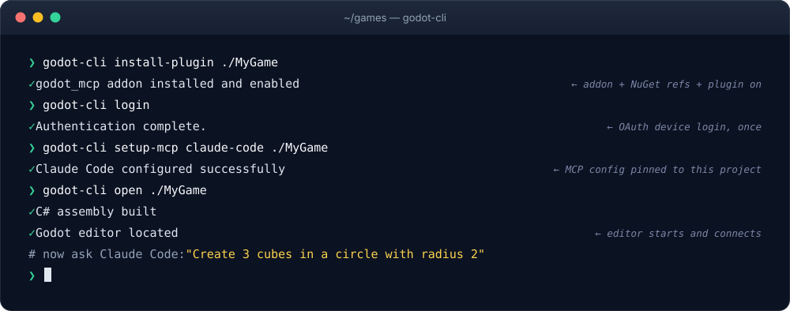

<div align="center">

<p></p>

[](https://www.npmjs.com/package/godot-cli) [](https://nodejs.org/) [](https://github.com/IvanMurzak/Godot-MCP/blob/main/LICENSE) [](https://discord.gg/cfbdMZX99G) [](https://stand-with-ukraine.pp.ua)

[English](../README.md) · [中文](README.zh-CN.md) · [日本語](README.ja.md) · [Español](README.es.md) · **Português** · [فارسی](README.fa.md) · [हिन्दी](README.hi.md) · [العربية](README.ar.md)

</div>

O **`godot-cli`** é a linha de comando do [Godot-MCP](https://github.com/IvanMurzak/Godot-MCP), o addon do editor Godot que conecta agentes de IA (Claude Code, Cursor, Codex, GitHub Copilot, …) ao editor Godot pelo [Model Context Protocol](https://modelcontextprotocol.io/). É o irmão do [`unity-mcp-cli`](https://www.npmjs.com/package/unity-mcp-cli) e do [`unreal-mcp-cli`](https://www.npmjs.com/package/unreal-mcp-cli), apoiado pelo [ai-game.dev](https://ai-game.dev).

<p align="center"></p>

<a id="features"></a>
## Recursos

✅ **Instalação em um comando** — `install-plugin` adiciona o addon, as referências NuGet e o habilita\
✅ **Login uma vez** — `login` usa o fluxo OAuth por dispositivo; o editor adota a credencial\
✅ **Configuração de agentes** — `setup-mcp` escreve a config MCP para Claude Code, Cursor, Codex e mais\
✅ **Controle do editor** — `open`, `close`, `status` e `wait-for-ready` para o editor de um projeto\
✅ **Executar ferramentas** — `rql`, `exec`, `run-tool` iniciam um editor headless quando nenhum está rodando\
✅ **CI headless** — `check`, `import`, `test`, `export` e `run-script` sem um editor aberto\
✅ **Extensões** — `install-extension` adiciona módulos RQL opcionais; `update` atualiza tudo

<a id="quick-start"></a>
## Início rápido

Requer [Node.js](https://nodejs.org/) 22.14 ou posterior, e um editor Godot 4.3+ .NET com o SDK do .NET 8. Funciona no Windows, macOS e Linux.

```bash
npm install -g godot-cli

godot-cli install-plugin ./MyGodotProject          # addon + referências NuGet + habilitar o plugin
godot-cli login                                    # login no ai-game.dev, uma vez por máquina
godot-cli setup-mcp claude-code ./MyGodotProject   # escrever a config MCP do agente
godot-cli open ./MyGodotProject                    # compilar C#, iniciar o editor, conectar
godot-cli wait-for-ready ./MyGodotProject          # esperar até o plugin responder
```

Execute C# ou RQL no editor a partir da pasta do projeto; um editor headless inicia quando nenhum está aberto:

```bash
godot-cli exec 'EditorInterface.Singleton.GetEditedSceneRoot()?.Name'
godot-cli rql 'nodes | where name starts-with "Tree" | count'
```

Ou execute qualquer comando sem instalar: `npx godot-cli install-plugin ./MyGodotProject`.

<a id="commands"></a>
## Comandos

- **`open [path]`** — Compila o assembly C# do projeto (para que o addon carregue na primeira abertura — veja abaixo), resolve o binário do editor Godot e executa `--editor --path <project>` com as variáveis de ambiente de conexão `GODOT_MCP_*`. `--no-build` pula a build. `--headless` inicia uma sessão de editor sem janela (veja [`exec`](#exec)).
- **`exec [code]`** — Executa C# no editor através do `script-execute` (veja [`exec`](#exec)): reutiliza um editor em execução, senão inicia um headless e o mantém aquecido.
- **`create-project [path]`** — Cria um novo projeto Godot; `--dotnet` também escreve um `.csproj` Godot.NET.Sdk, `--name` define o nome.
- **`build [path]`** — Compila o assembly C# do projeto (`dotnet build`) para que o addon `godot_mcp` carregue na próxima abertura do editor. Projetos só com GDScript (sem `.csproj`) são um no-op. É a mesma build que `open` executa antes de abrir.
- **`rql [query]`** — Uma query RQL na linha de comando, sem JSON: `godot-cli rql 'nodes | where name starts-with "Tree" | count'`. Uma query cuja última etapa é `set` ou `call` vai para `rql-mutate` (`--dry-run`, `--max-targets <n>`), qualquer outra para `rql-query`; `--schema [type]` executa `rql-schema`; `-f <file>` (`-f -`: stdin) lê a query quando um shell remove suas aspas. Inicia um editor headless como `run-tool`. Depois de `SaveScene()`, `NewScene(...)`, `CreateResource(...)` ou de uma edição `godot.resource(...)` ela imprime os arquivos escritos (`Saved to disk: res://scenes/forest.tscn`); um operador escrito como em outra linguagem (`startsWith`, `like`) recebe uma dica com a grafia do RQL. `rql --help` lista receitas.
- **`run-tool <tool> [path]`** — POST para `<url>/api/tools/<tool>` com entrada JSON. O modo texto imprime uma resposta de texto como texto (`--raw`: o JSON da resposta; `--verbose`: também o endpoint). Quando nenhum editor responde no servidor local do projeto, ele inicia um headless como `exec` (`--no-start` desativa; `--once` o fecha após a chamada).
- **`run-system-tool <tool> [path]`** — POST para `<url>/api/system-tools/<tool>` (ferramentas não expostas a clientes MCP). Mesmo auto-início de `run-tool`.
- **`check [path]`** — Portão de CI sem um editor em execução: import, `dotnet build`, boot do editor e uma verificação de carga de GDScript, julgados pelos logs (veja [comandos headless](#headless-commands-check-import-test-export-run-script)).
- **`import [path]`** — `godot --headless --import`, falhando em erros de import e de script no log.
- **`test [path]`** — Executa os testes GUT ou gdUnit4 do projeto em modo headless com um timeout rígido; o veredito vem do relatório JUnit e do log.
- **`export <preset> <output>`** — Exporta um preset em modo headless (`--debug`, `--pack`); verifica os templates de exportação antes e a saída depois.
- **`run-script <script> [args...]`** — Executa um GDScript `SceneTree` de uma vez (`godot --headless -s`); sai com 0 apenas após `quit(0)`.
- **`commands`** — Manifesto legível por máquina de cada comando, seus argumentos e opções, e os códigos de saída (`--format json`).
- **`tools [name]`** — As ferramentas de IA do editor (MCP `tools/list`; inicia um editor headless quando nenhum responde, armazena a lista em cache em `.ai-game-dev/tools.json`, ignorado pelo git). Com um nome: sua descrição, argumentos e um exemplo de chamada `run-tool`. `--refresh` pergunta ao editor de novo; `--no-start` usa o cache ou a lista embutida.
- **`status [path]`** — Detecta um editor Godot em execução para o projeto e sonda a saúde do servidor MCP.
- **`wait-for-ready [path]`** — Consulta o servidor MCP até ele responder `ping`.
- **`login [path]`** — Autentica na nuvem ai-game.dev via o fluxo OAuth 2.1 de autorização por dispositivo (RFC 8628) — abre um navegador e salva uma credencial de nuvem no armazenamento compartilhado da máquina (`~/.ai-game-dev/credentials.json`) que o plugin do editor adota automaticamente. Veja a seção `login` abaixo para as flags `--project` / `--base-url` / `--force` / `--tools-only` / `--yes`.
- **`setup-mcp <agent> [path]`** — Escreve a config do cliente MCP do agente apontando para a URL fixada ao projeto `<host>/mcp/p/<pin>` (para que o agente chegue ao editor *deste* projeto). No modo Cloud a config carrega a chave deste projeto (`Authorization: Bearer agd_pk_…`). Adicione `--no-pin` para a URL simples `<host>/mcp`, `--oauth` para uma config só com URL, `--regenerate-key` para substituir a chave.
- **`setup-skills <agent> [path]`** — Escreve a skill de agente `godot-cli` (fluxo de partida a frio, receitas RQL, códigos de saída) e `ai-game-dev-app` no caminho de skills do agente, offline. `--list` mostra o suporte a skills de cada agente.
- **`configure [path]`** — Lista / mostra / oculta ferramentas, prompts e recursos no `.godot-mcp/features.json` local do projeto (`--enable-*` mostra, `--disable-*` oculta; uma ferramenta oculta ainda executa quando chamada pelo nome).
- **`close [path]`** — Para graciosamente o editor Godot em execução para um projeto (`--force` para matar à força). Também para o servidor MCP local que esse editor executou, se ele o sobreviveu. `--owned-only` fecha apenas um editor que o `godot-cli` iniciou (`exec` / `open --headless`).
- **`install-plugin [path]`** — Instala o addon `godot_mcp` de ponta a ponta: materializa `res://addons/godot_mcp/` (baixa a release correspondente do GitHub, ou `--source <path>` uma cópia local), adiciona as `PackageReference`s NuGet de que o addon instalado precisa + o `<EmbeddedResource>` do catálogo de extensões ao `.csproj` do projeto, e habilita o plugin. Idempotente.
- **`install-extension <id> [path]`** — Instala uma **extensão** do Godot-MCP (um pacote de módulo RQL opcional) no projeto: resolve `<id>` no catálogo compartilhado, adiciona/atualiza sua `<PackageReference>` no `.csproj` do projeto, depois recompila para restaurar. Idempotente — comportamento idêntico ao do dock no editor.
- **`remove-plugin [path]`** — Desabilita o addon `godot_mcp` em `project.godot` `[editor_plugins]` (não apaga os arquivos do addon).
- **`update [path]`** — Atualiza tudo: o addon `godot_mcp` do projeto e as extensões instaladas para suas versões mais recentes, depois o próprio `godot-cli`. Fora de um projeto atualiza só a CLI. `--check` relata (saída 2 quando algo está desatualizado); `--no-self`, `--no-project`, `--no-extensions` pulam um passo.

<a id="build-before-open-open--build"></a>
### Build antes de abrir (`open` / `build`)

`open` **compila o assembly C# do projeto antes de abrir o editor**. O Godot instancia o `EditorPlugin` de um addon habilitado assim que o editor carrega — então em uma *primeira* abertura de um projeto C# que nunca foi compilado, nenhum assembly existe ainda e o Godot falha com `Unable to load addon script 'res://addons/godot_mcp/Editor/GodotMcpPlugin.cs' … Disabling the addon`. Compilar antes garante que o assembly está presente quando o addon é instanciado.

- A build é a mesma que `godot-cli build` executa: `dotnet build <project>.csproj --configuration Debug`.
- **Projetos só com GDScript** (sem `.csproj` na raiz) são pulados automaticamente — não há o que compilar.
- A build roda **incondicionalmente** para projetos C#; `dotnet build` é incremental, então um projeto atualizado é um no-op rápido. Passe `--no-build` a `open` para pulá-la (ex.: você já compilou, ou quer abrir o mais rápido possível).
- Se a build **falha**, `open` **não** abre o editor (abrir só reproduziria a falha de desabilitar o addon); o erro é mostrado no lugar.

<a id="editor-resolution-open"></a>
### Resolução do editor (`open`)

`open` localiza o binário do editor Godot nesta ordem:

1. `--editor-path <path>` (explícito).
2. Variáveis de ambiente `GODOT_BIN` / `GODOT4_BIN`.
3. O primeiro binário Godot correspondente no `PATH` (a build mono é preferida no Windows).
4. Diretórios de instalação comuns por sistema operacional — o Windows prefere a build mono; o macOS resolve o binário `.app/Contents/MacOS/Godot`; o Linux varre locais comuns de binários extraídos.

<a id="connection-env-vars"></a>
### Variáveis de ambiente de conexão

`open` as encaminha ao processo do editor (os nomes correspondem ao `GodotMcpConfig` do addon):

| Flag | Variável de ambiente |
| --- | --- |
| `--url <host>` | `GODOT_MCP_HOST` |
| `--cloud-url <url>` | `GODOT_MCP_CLOUD_URL` |
| `--token <token>` | `GODOT_MCP_TOKEN` |
| `--auth None\|Required` | `GODOT_MCP_AUTH_OPTION` |
| `--mode Cloud\|Custom` | `GODOT_MCP_CONNECTION_MODE` |
| `--log-level <level>` | `GODOT_MCP_LOG_LEVEL` |

O padrão do addon é Cloud (ai-game.dev): não precisa de portas abertas, evita conflitos de porta com outros programas e é gratuito. Para um servidor local que exige um token escolhido por você (trabalho offline ou isolado da rede), abra o editor no modo Custom com ele e depois pressione **Start Server** no dock (`Required` seleciona a autorização `token`):

```bash
godot-cli open ./MyGodotProject --mode Custom --auth Required --token <token>
```

<a id="server-url-resolution-run-tool--status--wait-for-ready"></a>
### Resolução da URL do servidor (`run-tool` / `status` / `wait-for-ready`)

A URL base do servidor para a qual uma chamada de ferramenta faz POST (`<base>/api/tools/<name>`, ou `<base>/api/system-tools/<name>` para ferramentas de sistema — `status` / `wait-for-ready` sondam a ferramenta de sistema `ping`) é resolvida assim:

1. `--url <url>` (sobrescrita explícita).
2. Env `GODOT_MCP_HOST` (host do modo Custom).
3. Env `GODOT_MCP_CLOUD_URL` → a URL do **hub `/mcp`** da nuvem (`/mcp` é acrescentado se ausente).
4. `GODOT_MCP_CONNECTION_MODE=Cloud` → o hub de nuvem padrão `https://ai-game.dev/mcp`.
5. O **marcador de projeto registrado** (`.ai-game-dev/project.json` `serverTarget`, escrito por `install-plugin --enroll`): um alvo hospedado roteia ao seu hub `/mcp`, um alvo `localhost` é usado literalmente. Isso torna um **projeto de nuvem registrado alcançável sem nenhuma config de ambiente** — a credencial de nuvem persistida (armazenamento por projeto `<project>/.ai-game-dev/`, depois o antigo sink de projeto, depois `~/.ai-game-dev/credentials.json`) é usada automaticamente, renovada ao expirar.
6. Fallback local: `http://localhost:<derived-port>`, a porta determinística v2 do caminho do projeto que o addon do editor vincula localmente (um `portOverride` do marcador vence sobre a porta derivada do hash).

Os caminhos de nuvem carregam o segmento de hub `/mcp` para que a requisição chegue ao hub e não ao backend da nuvem (que não serve `/api/tools/*`). Passe `--url http://localhost:<port>` para mirar explicitamente um servidor local/auto-hospedado.

`run-tool`, `run-system-tool` e `exec` substituem o passo 6 pelo **modo de conexão do projeto**, lido do mesmo jeito que o addon o lê (`GODOT_MCP_CONNECTION_MODE`, o `.env` do projeto, o `user://godot-mcp-config.json` persistido, senão Cloud, o padrão do addon). O modo Custom usa o servidor local acima. O modo Cloud usa o hub de nuvem com o login da máquina (nenhum editor é iniciado: só um editor conectado ao ai-game.dev responde). Se esta máquina **nunca** fez login no ai-game.dev, o servidor local do projeto é usado em vez disso, com um aviso (um editor iniciado agora o serve; nada é persistido). Um login que existe mas não pode ser usado (expirado, revogado, ilegível) é um erro (saída 6, `NOT_AUTHENTICATED`): uma máquina logada nunca é trocada para um servidor local. O mesmo vale para `open`, `tools` e `open --headless`: em um projeto Cloud de uma máquina logada, `open --headless` não inicia editor algum e sai com 6 (use `open`, `run-tool` e `exec`, que passam pelo ai-game.dev). Um `--url` / `--token` explícito é usado como está; um `--url` / `GODOT_MCP_HOST` não local é chamado diretamente por `exec` e recusado por `open --headless` (um editor headless é local).


<a id="exec"></a>
## `exec`

Executa C# no editor Godot do projeto (a ferramenta `script-execute` do addon, sobre o [Code-Exec](https://github.com/IvanMurzak/Code-Exec)):

```bash
godot-cli exec '1 + 2'                                   # → System.Int32: 3
godot-cli exec -f snippet.cs --using MyGame.Gameplay      # código de um arquivo ("-" ou um pipe: stdin)
godot-cli exec 'Helper.Twice(21)' --include helpers       # arquivos/pastas .cs em <project>/.ai-game-dev/snippets
```

O código é feito de instruções simples; a última expressão é o resultado. A saída é o valor (`Type: value`) e, sob `logs:`, o que o código imprimiu (`Console`; `GD.Print` / push_warning / push_error com Godot.NET.Sdk 4.5+). Um erro de compilação aponta para a linha do snippet (`snippet.cs(2,12)`) e sai com 6.

- **Um editor do projeto em execução** (o seu, com janela, ou um que o `godot-cli` iniciou) é reutilizado e nunca fechado. O seu deve servir o servidor **local** do projeto (dock: modo Custom, servidor iniciado).
- **Nenhum rodando:** o assembly C# é compilado, depois um editor **headless** inicia (`--headless --editor --path`, ou com janela via `--window`) conectado ao servidor local do projeto (`http://localhost:<porta derivada>`, ou `--url`), que seu plugin inicia sozinho. Um headless encerra após `--idle <segundos>` (padrão 300, `0` = nunca) sem chamadas de ferramenta, salvando as cenas abertas que têm arquivo (um com janela permanece aberto). Chamadas paralelas compilam uma vez e iniciam um editor; um editor do usuário cujo servidor local não responde é aguardado por até 60 s, depois reportado.
- `open --headless [--idle-timeout <s>]` inicia a mesma sessão sem executar código; `close --owned-only` a salva e encerra (através da ferramenta `session-close` do plugin — nunca o editor de um usuário).

As sessões usam o `EditorSession` do [`@baizor/gamedev-cli-core`](https://www.npmjs.com/package/@baizor/gamedev-cli-core): a lease `<project>/.ai-game-dev/session.json` marca um editor como iniciado pela CLI (só tal editor é fechado) e registra o servidor em que ele roda: enquanto esse editor comprovadamente vive, chamadas posteriores de `exec` / `open` / `close` usam esse servidor, diga o que disser `--url`. O `<project>/.ai-game-dev/session.lock` faz chamadas concorrentes iniciarem um único editor: a build C# roda sob ele, só na chamada que inicia o editor. Ambos os arquivos estão listados em `<project>/.ai-game-dev/.gitignore`. O editor recebe `AIGD_SESSION_IDLE_SECONDS`, `AIGD_SESSION_OWNER=cli` e `AIGD_SESSION_NONCE`, além de `GODOT_MCP_CONNECTION_MODE=Custom`, `GODOT_MCP_HOST` e `GODOT_MCP_START_SERVER=true`. Opções: `--ready-timeout <ms>`, `--timeout <ms>` (chamada de ferramenta, padrão 310000: pouco mais que o `tool-timeout` de 5 minutos do servidor), `--no-build`, `--editor-path`, `--token`, `--raw`.

`run-tool` / `run-system-tool` seguem a mesma política quando a chamada é recusada em uma URL **local** de um projeto Godot: eles iniciam um editor headless (compilando C# antes, a menos que `--no-build`), depois tentam de novo. Um editor em execução é reutilizado e nunca fechado; `--once` fecha o editor depois apenas quando esta chamada o iniciou. `--no-start` desliga isso, e uma URL de nuvem ou remota nunca inicia nada. Opções: `--editor-path`, `--ready-timeout <ms>`.

<a id="exit-codes-and-output-formats"></a>
## Códigos de saída e formatos de saída

Os códigos de saída são compartilhados com `unity-mcp-cli` e `unreal-mcp-cli` (`godot-cli commands --format json` os lista):

| Código | Significado |
| --- | --- |
| 0 | Sucesso |
| 1 | Erro genérico ou não classificado; também uma execução interrompida por Ctrl+C / SIGTERM (a árvore de processos do Godot é morta) |
| 2 | Erro de uso: comando ou opção desconhecidos, valor de flag ou argumento inválido, uma ferramenta desconhecida (`NOT_FOUND`) (`--help` / `--version` saem com 0) |
| 6 | O comando rodou e falhou: a ferramenta devolveu um erro, erros de script ou compilação, nenhum veredito de teste, credenciais recusadas |
| 7 | O editor ou o servidor MCP está inalcançável (também HTTP 502) |
| 8 | Os testes rodaram e pelo menos um falhou (uma falha de setup/teardown no nível da suíte conta) |
| 14 | Timeout (também HTTP 408 / 504) |
| 17 | O servidor está ocupado (HTTP 503 / 429); a chamada não foi executada |
| 18 | O editor está bloqueado por um diálogo modal (reservado: não detectável em um Godot headless) |

`update --check` continua saindo com 2 quando algo está desatualizado.

**Uma chamada de ferramenta que não teve sucesso** (`run-tool`, `run-system-tool`, `exec`, `rql`, `tools`) mapeia para o mesmo código de saída e código de erro nas três CLIs (a tabela vive no `@baizor/gamedev-cli-core`; `commands --format json` a lista como `errorCodes`). Quando o servidor MCP respondeu, seu status HTTP decide, e o erro do envelope o carrega: `errors[{code, message, httpStatus}]`.

| Condição | Status HTTP | Saída | `errors[].code` |
|---|---|---|---|
| Argumentos inválidos: uma flag inválida, argumentos de ferramenta que a CLI ou o servidor rejeitou (qualquer 4xx não listado aqui) | 400 (um 422 `[invalid_params]`) | `2` | `USAGE` |
| Nenhuma ferramenta com esse nome (liste-as com `tools`), ou nenhum projeto no caminho | 404 | `2` | `NOT_FOUND` |
| Nenhuma credencial utilizável, ou o servidor as recusou: faça login com `login` | 401, 403 | `6` | `NOT_AUTHENTICATED` |
| A ferramenta rodou e reportou um erro (`status: "error"`, qualquer 5xx não listado aqui) | 409, 422, 500 | `6` | `TOOL_FAILED` |
| O código do projeto não compilou, então nenhum editor foi iniciado | — | `6` | `COMPILATION_FAILED` |
| Conexão recusada ou resetada, nenhum plugin de engine conectado ao servidor, plugin perdido após o envio da chamada | 502 | `7` | `UNREACHABLE` |
| Nenhuma resposta a tempo: `--timeout`, ou o próprio timeout de ferramenta do servidor | 408, 504 | `14` | `TIMEOUT` |
| Ocupado e não executou a chamada (recarregando, limitado por taxa, outra chamada da CLI segura o editor); tente de novo depois | 503, 429 | `17` | `BUSY` |
| Qualquer outra coisa (a chamada foi abortada, um erro inesperado) | — | `1` | `ERROR` |

`--format text|json|ndjson` (padrão `text`) é aceito por `run-tool`, `run-system-tool`, `exec`, `status`, `wait-for-ready`, `check`, `import`, `test`, `export`, `run-script` e `commands`. `json` imprime exatamente um envelope no stdout:

```json
{ "success": false, "command": "check", "data": { "...": "..." },
  "errors": [{ "code": "SCRIPT_ERRORS", "message": "res://player.gd:12: error: Expected expression." }],
  "warnings": [] }
```

`ndjson` imprime eventos no stderr, um objeto JSON por linha (`{"type":"progress","command":…,"message":…}`, e todas as outras linhas como `{"type":"log","command":…,"level":"info|error","message":…}`), e o envelope como uma linha no stdout. Em ambos, logs, spinners e títulos vão para o stderr sem cor. Códigos de erro: `USAGE`, `TOOL_FAILED`, `UNREACHABLE`, `TIMEOUT`, `BUSY`, `AWAITING_INPUT`, `TESTS_FAILED`, `TEST_RUN_ERROR`, `COMPILATION_FAILED`, `SCRIPT_ERRORS`, `IMPORT_FAILED`, `PROJECT_OPEN`, `NOT_FOUND`, `EXPORT_FAILED`, `NOT_AUTHENTICATED`, `CLOUD_PROJECT`, `ERROR`. `--raw` continua funcionando como antes.

<a id="headless-commands-check-import-test-export-run-script"></a>
## Comandos headless (`check`, `import`, `test`, `export`, `run-script`)

Estes executam o Godot sem uma sessão de editor e não precisam de servidor MCP. O código de saída do Godot não é um veredito em modo headless (um `--import` com um erro de parse de GDScript, ou um addon que falha ao carregar, ainda sai com 0), então cada comando julga a execução pelo seu log (`SCRIPT ERROR`, `ERROR:`, `Parse Error`), por um marcador que prova que o passo rodou, e pelos arquivos que ele deve produzir. Cada processo recebe um `--timeout` rígido (a árvore de processos inteira do Godot é morta: saída 14). Logs e scripts temporários vão para `<project>/.godot/godot-cli/`. `check`, `import`, `test` e `export` recusam um projeto que está aberto em um editor (saída 6, `PROJECT_OPEN`: um import disputa `.godot/` com esse editor); `--allow-open` sobrepõe isso, `close` para um editor do `godot-cli`. O binário vem de `--editor-path`, `GODOT_BIN`, `PATH` ou das pastas de instalação habituais.

```bash
godot-cli check                     # 0 limpo, 6 SCRIPT_ERRORS / COMPILATION_FAILED, 14 timeout
godot-cli check --strict            # avisos dos compiladores GDScript e C# também falham
godot-cli test --format github      # anotações ::error; 0 aprovado, 8 falhas, 6 sem veredito
godot-cli export "Windows Desktop" build/game.exe
godot-cli run-script tools/migrate.gd -- --dry-run
```

- **`check [path] [--strict] [--include-addons]`** executa quatro processos separados (um único `--build-solutions --quit` a frio crasha com plugins C# `[Tool]`): `--headless --import`; `dotnet build` para um projeto C# (erros como `file(line,col): error CS…`); `--headless --editor --quit`, que deve imprimir `[Godot-MCP] plugin loaded` quando o addon está habilitado; e um passe de GDScript que carrega cada `.gd` sob `res://` (`res://addons/` só com `--include-addons`) e reporta erros de parse como `res://file:line`. `--strict` também falha em avisos de GDScript (os avisos do nível Warn do projeto elevados a erros em memória, nunca salvos) e avisos `CS` de C#. Mensagens do engine (os avisos de runtime de um plugin, por exemplo) são listadas como avisos e nunca fazem a verificação falhar.
- **`import [path]`** falha em erros de script (`SCRIPT_ERRORS`) e em recursos que falham ao importar (`IMPORT_FAILED`).
- **`test [path]`** encontra GUT (`addons/gut`) ou gdUnit4 (`addons/gdUnit4`), importa o projeto (`--no-import` pula isso) e executa o script de linha de comando do runner com um relatório JUnit (`-gjunit_xml_file`, ou gdUnit4 `-rd`; gdUnit4 roda com `--ignoreHeadlessMode -c`). Saída 0 quando todos os testes passam, 8 em falhas, 6 (`TEST_RUN_ERROR`) quando não há relatório, nenhum teste rodou, ou um script de teste falhou ao carregar (seus testes faltam no relatório, então ele não pode passar), 6 (`NOT_FOUND`) com uma dica de instalação quando nenhum runner está instalado. `--runner gut|gdunit4`, `--dir <dir>` (repetível; padrão `res://test`, `res://tests`, ou o `.gutconfig.json` do GUT), `--filter <text>` (scripts de teste cujo nome de arquivo o contém), `--output <file>` (copiar o XML JUnit), `--format text|json|ndjson|github`.
- **`export <preset> <output> [--debug|--pack]`** verifica que `export_presets.cfg` tem o preset e que os templates de exportação para a versão do editor estão instalados (a menos que `--pack` ou que o preset nomeie seu próprio template), executa `--export-release|--export-debug|--export-pack`, e falha (`EXPORT_FAILED`) a menos que o arquivo de saída exista, não esteja vazio e tenha sido escrito por esta execução, e o log não tenha erros de exportação (o Godot escreve o executável e sai com 0 mesmo quando, digamos, o publish de C# falhou por falta de um `.sln`).
- **`run-script <script> [args...]`** executa `godot --headless --path <project> -s <script> -- <args>`: o script estende `SceneTree` ou `MainLoop` e termina com `quit(code)`. Saída 0 para `quit(0)`; 6 para outro código (`data.scriptExitCode`) ou um script que falhou ao carregar; 14 em `--timeout` (padrão 300000 ms). Ele não importa, então também roda enquanto um editor tem o projeto aberto.

<a id="login"></a>
## `login`

`godot-cli login` autentica a conexão de **nuvem** do plugin do editor no [ai-game.dev](https://ai-game.dev) usando o **fluxo OAuth 2.1 de autorização por dispositivo** (RFC 8628) — ele imprime um código de usuário curto + a URL de verificação, abre seu navegador e consulta até você aprovar:

```bash
godot-cli login                       # login uma vez por máquina (padrão)
godot-cli login --project ./MyGame    # manter uma credencial por projeto em vez disso
godot-cli login --base-url <url>      # autenticar contra um servidor não padrão
godot-cli login --force               # reautenticar sobre uma credencial existente
godot-cli login --tools-only         # CI/automação: só credencial de ferramentas (sem adoção pelo App)
godot-cli login --yes                # não interativo: confirmar a substituição da credencial de outra conta
```

- Por padrão a credencial é salva no **armazenamento da máquina** compartilhado `~/.ai-game-dev/credentials.json` (`0600` em POSIX / DPAPI no Windows) — faça login **uma vez por máquina** e o plugin do editor Godot a adota automaticamente, então `godot-cli open --mode Cloud` conecta **sem `--token`**.
- O login padrão autentica a máquina inteira: o fluxo solicita uma concessão de **escopo de agente** e deriva dela a **credencial de ferramentas (plugin)** mais restrita via troca de token RFC 8693, de modo que toda ferramenta AI-Game-Dev na máquina (plugins de engine, CLIs, o App desktop) adota o login.
- `--tools-only` cria **apenas** a credencial de ferramentas — nada com escopo de agente é armazenado, o App desktop não pode adotar o login, e o runner aparece como seu próprio dispositivo revogável no [ai-game.dev](https://ai-game.dev). Use-o para CI e runners de automação compartilhados.
- Se a máquina já guarda a credencial de **outra conta**, o login pergunta antes de substituí-la (recusar revoga a credencial recém-emitida e deixa o armazenamento intocado). Passe `--yes` para confirmar de forma não interativa.
- `--project <path>` (ou o `[path]` posicional) mantém uma credencial por projeto (`<path>/.ai-game-dev/credentials.json`, ignorada pelo git) para contas por projeto. O antigo sink por projeto `<path>/.godot-mcp/credentials.json` **não é mais escrito** — ele ainda é lido (e migrado ao armazenamento da máquina no primeiro uso) por uma release.
- O fluxo persiste o conjunto **completo** de credenciais (token de acesso + refresh token rotativo + expiração) — **nenhum personal access token (PAT) é jamais emitido**. Em qualquer falha nada é escrito, então uma credencial existente sobrevive intacta a uma negação / expiração / erro de rede. Os comandos renovam um token de acesso expirado automaticamente (via `@baizor/gamedev-cli-core`), então uma máquina logada permanece logada sem reexecutar `login`.

<a id="setup-skills"></a>
## `setup-skills`

`godot-cli setup-skills <agent> [path]` gera **arquivos de skill** de agente de IA para um projeto Godot sob o caminho de skills do agente selecionado (ex.: `.claude/skills` do Claude Code). Use `--list` para ver cada agente e seu suporte a skills.

```bash
godot-cli setup-skills claude-code            # gerar em ./.claude/skills
godot-cli setup-skills cursor ./MyGame        # gerar em MyGame/.cursor/skills
godot-cli setup-skills --list                 # listar agentes + seus caminhos de skills
```

Ele escreve, offline (sem editor, sem servidor, sem rede):

- `godot-cli/SKILL.md`: como um agente usa esta CLI de uma partida a frio: o primeiro comando de editor inicia um editor headless, `rql` com receitas para cenas, nós e recursos, `check` / `test`, `--format json`, o que cada código de saída significa. É curto de propósito (um agente mantém no contexto cada byte que lê); `references/rql.md` e `references/install.md` guardam a profundidade, lidos só quando necessário. As receitas vêm da mesma fonte que `godot-cli --help` e `rql --help`, então a skill e a ajuda não podem divergir.
- `ai-game-dev-app/SKILL.md`: o app companheiro, para ferramentas criativas que a CLI não tem.

Ele é **idempotente**: reexecutar reescreve os mesmos bytes. Ele remove as skills `godot-mcp` / `godot-mcp-<family>` que versões anteriores geravam de um catálogo escrito à mão. Skills por ferramenta são trabalho do addon: ele as gera das ferramentas que realmente registra sempre que o editor roda (interruptor no painel Skills do addon), junto com seu guia `godot-cli-install`.

<a id="install-plugin"></a>
## `install-plugin`

`godot-cli install-plugin [path]` é um **instalador de verdade** — ele faz uma instalação de terminal do zero produzir um projeto funcional, em um comando idempotente:

```bash
godot-cli install-plugin ./MyGodotProject                      # baixar a release correspondente + instalar
godot-cli install-plugin --version <x.y.z> ./MyGodotProject   # fixar uma release específica do addon
godot-cli install-plugin --source ./Godot-MCP/addons/godot_mcp ./MyGodotProject   # cópia offline / dev
```

Ele executa quatro passos:

1. **Materializar `res://addons/godot_mcp/`.** Por padrão ele baixa `godot-mcp-addon-<version>.zip` via HTTPS **somente de github.com** (a release `v<version>` de `IvanMurzak/Godot-MCP`; a versão padrão é a versão da própria CLI). Hosts fora de `github.com` e `http` puro são rejeitados. Com `--source <path>` ele copia o addon de um diretório local (sem rede) — `<path>` pode ser um diretório que *é* `addons/godot_mcp` ou um que o *contém*.
2. **Adicionar os pacotes NuGet** de que o addon precisa (`com.IvanMurzak.ReflectorNet`, `com.IvanMurzak.McpPlugin`) ao `.csproj` do projeto, de forma idempotente — adicionando quando ausente, reconciliando uma versão desatualizada e deixando um pin correto intocado. As versões vêm do addon sendo instalado: seu `nuget-deps.json` (gerado do `Godot-MCP.csproj` em cada zip de release pelo workflow de release), ou, com `--source` apontando para um checkout do Godot-MCP, o `Godot-MCP.csproj` desse checkout. Zips de addon antigos sem o manifesto caem nas versões embutidas na CLI, com um aviso.
3. **Incorporar o catálogo de extensões** (`<EmbeddedResource Include="addons/godot_mcp/extensions.catalog.json" LogicalName="Godot-MCP.extensions.catalog.json" />`) ao `.csproj` do projeto, de forma idempotente. Sem ele o registro de extensões do addon não lê catálogo algum em tempo de execução do editor e o **painel Extensions fica vazio**. Fonte única + testado por paridade contra o csproj do addon junto com os pins. Ele também define `<EnableDynamicLoading>true</EnableDynamicLoading>` (o template do Godot já o tem; sem ele um jogo executado pelo editor não consegue instanciar scripts C#).
4. **Habilitar o plugin** em `project.godot` `[editor_plugins]`.

Ele é seguro como biblioteca (devolve uma união `{ kind: 'success' | 'failure' }`; nunca lança exceções além da fronteira pública) e idempotente — reexecutar em um projeto já instalado não reporta mudança.

<a id="install-extension"></a>
## `install-extension`

`godot-cli install-extension <id> [path]` instala uma **extensão** opcional do Godot-MCP (um pacote NuGet opcional que estende o RQL; ele não adiciona ferramentas próprias) em um projeto Godot C# — o canal de terminal/biblioteca para a mesma instalação que o dock **Extensions** do editor realiza:

```bash
godot-cli install-extension com.IvanMurzak.Godot.MCP.CSG ./MyGodotProject   # adicionar/atualizar a PackageReference
godot-cli install-extension "CSG Tools"                                      # resolver pelo nome; padrão cwd
godot-cli install-extension com.IvanMurzak.Godot.MCP.CSG --version <x.y.z>   # sobrescrever o pin do catálogo
```

- Resolve `<id>` contra o **catálogo de extensões compartilhado** (`addons/godot_mcp/extensions.catalog.json` — a fonte única da verdade que o dock, a CLI e o app consomem), casando por id de pacote (depois nome), sem distinção de maiúsculas.
- Faz read-modify-write de um `<PackageReference Include="<packageId>" Version="<version>" />` no `.csproj` raiz do projeto: **adicionado** quando ausente, versão **elevada** só quando o catálogo (ou `--version`) fixa uma versão mais nova, e um **no-op** quando já está atualizado — depois pede que você recompile (`godot-cli build`) para que o Godot restaure + compile o novo pacote.
- Comportamento idêntico ao `ExtensionInstaller` do dock (as mesmas regras de adicionar / atualizar / no-op + comparação numérica de versões; verificadas por um conjunto de cenários compartilhado em ambos os lados).

<a id="library-api"></a>
## API de biblioteca

O pacote também exporta uma biblioteca sem efeitos colaterais (a entrada `.`):

```ts
import { openProject, runTool, setupMcp, installPlugin, installExtension, execCode, ensureEditor } from 'godot-cli';

// The shared extension catalog + lookup helpers are exported too, so a GUI (the app)
// can render the same list the dock + CLI install from:
import { EXTENSIONS_CATALOG, findExtension } from 'godot-cli';

// The headless commands, their log/JUnit parsers and the exit codes:
import { checkProject, importProject, runTests, exportProject, runScript, parseGodotLog, parseJUnit, ExitCode } from 'godot-cli';
```

Toda função devolve uma união discriminada (`{ kind: 'success', ... }` / `{ kind: 'failure', error }`) e nunca lança exceções além da fronteira pública.

<a id="development"></a>
## Desenvolvimento

```bash
npm install
npm run build   # tsc → dist/ (ESM)
npm test        # vitest
```


<a id="supported-ai-agents"></a>
## Agentes de IA suportados

O `godot-cli` escreve configs de cliente MCP prontas para uso para todos os principais agentes de IA de programação — execute `godot-cli setup-mcp <agent> [path]` para conectar um (e `godot-cli setup-skills <agent> [path]` para gerar seus arquivos de skill). Use `--list` em qualquer um dos comandos para ver todos os agentes suportados.

Os agentes suportados incluem Claude Code, Claude Desktop, Cursor, VS Code e Visual Studio (Copilot), GitHub Copilot CLI, Rider (Junie), Codex, Gemini, Antigravity, Cline, Open Code, Kilo Code e um cliente MCP genérico `custom`.

```bash
godot-cli setup-mcp --list                    # listar todos os ids de agente suportados
godot-cli setup-mcp claude-code ./MyGame      # escrever a config MCP do agente (fixada a este projeto)
godot-cli setup-mcp claude-code ./MyGame --no-pin   # escrever a URL simples, sem pin, <host>/mcp
godot-cli setup-mcp claude-code ./MyGame --oauth    # só URL: o agente faz login com seu próprio OAuth
godot-cli setup-mcp claude-code ./MyGame --regenerate-key   # nova chave do projeto; a antiga é revogada
```

No modo Cloud, `setup-mcp` escreve uma **chave de projeto** na config do agente para todo agente: `Authorization: Bearer agd_pk_…` (Codex: `http_headers`). Uma chave de projeto nunca expira, está vinculada ao pin deste projeto (não pode alcançar nenhum outro projeto da sua conta) e é criada uma vez por projeto com o login da sua máquina (`godot-cli login`), depois reutilizada de `~/.ai-game-dev/project-keys.json`. `--regenerate-key` a substitui e revoga a antiga. Sem um login de máquina (ou enquanto o servidor não pode emitir chaves) a config fica só com a URL e o agente autentica com seu próprio OAuth; `--oauth` pede essa config só com URL explicitamente. Um `--token` explícito sempre vence. Uma config de servidor local (`--url http://localhost:…`) nunca carrega chave de projeto.

> Para a documentação completa do projeto Godot-MCP, veja o [README principal](../../docs/README.pt-BR.md). Apoiado por **[ai-game.dev](https://ai-game.dev)**.
