<div align="center">

<p></p>

[](https://github.com/IvanMurzak/Godot-MCP/actions/workflows/ci.yml) [](https://github.com/IvanMurzak/Godot-MCP/releases/latest) [](https://godotengine.org/asset-library/asset/5245) [](https://www.npmjs.com/package/godot-cli) \
[](https://godotengine.org/) [](https://dotnet.microsoft.com/) [](../LICENSE) [](https://discord.gg/cfbdMZX99G) [](https://stand-with-ukraine.pp.ua)

[English](../README.md) · [中文](README.zh-CN.md) · [日本語](README.ja.md) · [Español](README.es.md) · **Português (Brasil)** · [فارسی](README.fa.md) · [हिन्दी](README.hi.md) · [العربية](README.ar.md)

</div>

**Godot-MCP** conecta agentes de IA (Claude Code, Cursor, Codex, GitHub Copilot, Gemini ou qualquer outro cliente [MCP](https://modelcontextprotocol.io/)) ao **editor Godot**. O agente pode ler e alterar suas cenas, nós, recursos e scripts, compilar e executar C# e visualizar capturas de tela. É um addon para o editor com uma CLI complementar, [`godot-cli`](../cli/README.md), e o equivalente para Godot do [Unity-MCP](https://github.com/IvanMurzak/Unity-MCP).

**Requisitos:** a versão **.NET** do editor Godot 4.3+ e o **SDK do .NET 8**, instalado uma única vez. Seus scripts podem continuar em GDScript. O `godot-cli`, opcional, requer Node.js 22.14+. Compatível com Windows, macOS e Linux.

<a id="why"></a>
## Por que usar Godot-MCP

✅ **Godot 4.3 a 4.7** — cada versão é testada no CI com 4.3, 4.4, 4.5, 4.6 e 4.7\
✅ **Compilações C# reais** — `script-build` executa `dotnet build` e retorna os erros do compilador\
✅ **Verificações de GDScript** — `script-validate` retorna diagnósticos de análise e compilação dos arquivos `.gd`\
✅ **Edições atômicas e reversíveis** — as alterações de uma consulta são aplicadas por completo ou não são aplicadas; cada operação pode ser desfeita com Ctrl+Z\
✅ **Capturas de tela** — do viewport, de uma câmera ou de um nó renderizado isoladamente, retornadas ao agente\
✅ **Ferramentas em runtime** — logs, reflexão de C# e erros de runtime de um jogo em execução (opcional)\
✅ **Nuvem gratuita ou uso totalmente local** — ai-game.dev por padrão (sem portas abertas) ou um servidor local sem conta\
✅ **Sem telemetria** — o addon e o `godot-cli` não enviam dados de uso ou análise

<a id="gdscript"></a>
## Compatível com projetos GDScript

O código do seu jogo continua em GDScript. O próprio addon é escrito em C#, então o projeto precisa de algumas etapas iniciais:

✅ **Editor Godot .NET** — abra o projeto na versão .NET do Godot 4.3+ (o mesmo projeto e as mesmas cenas)\
✅ **SDK do .NET 8** — instalado uma vez por máquina\
✅ **Solução C#** — em um projeto existente: **Project → Tools → C# → Create C# solution**; em um novo: `create-project --dotnet`\
✅ **O addon** — `godot-cli install-plugin` instala o addon, adiciona as referências NuGet e o ativa

**Um projeto que usa apenas GDScript precisa de uma solução C#?** Sim, uma vez: o addon é C# e é compilado no assembly C# do projeto. **Create C# solution** adiciona um arquivo `.csproj` e um `.sln` à raiz do projeto. Seus scripts `.gd`, cenas e recursos não são alterados e continuam funcionando como antes; o agente também pode ler, escrever e validar GDScript. As exportações usam os modelos de exportação .NET do Godot e incluem os pequenos assemblies de runtime do addon, que permanecem inativos a menos que seu código chame `GodotMcpRuntime.Initialize()` ([como removê-los da exportação](ARCHITECTURE.md#optional-strictly-zero-bytes-export-exclude-for-dev-only-users)).

<p align="center">
  
</p>

<a id="how-it-works"></a>
## Como funciona

<p align="center">
  
</p>

O addon se conecta a um servidor MCP, e seu agente se conecta ao mesmo servidor para chamar as ferramentas do addon. O servidor pode ser um [GameDev-MCP-Server](https://github.com/IvanMurzak/GameDev-MCP-Server) local, que o addon baixa e executa para você, ou o relay hospedado do [ai-game.dev](https://ai-game.dev). O addon não abre nenhuma porta.

<a id="stability"></a>
### Estabilidade

- **Versionamento:** o addon e o `godot-cli` sempre são lançados com o mesmo número de versão; leia as [notas da versão](https://github.com/IvanMurzak/Godot-MCP/releases/latest) antes de atualizar.
- **O que muda entre versões:** uma versão pode alterar as versões NuGet necessárias pelo addon e a versão do GameDev-MCP-Server que ele baixa. `godot-cli update` (ou `install-plugin`) grava as versões NuGet correspondentes ao addon instalado, e o addon baixa a versão compatível do servidor.
- **Critério para lançamento:** uma versão só é publicada depois que passam os testes de .NET, da CLI e do editor Godot 4.3–4.7.
- **Histórico de alterações:** cada [versão no GitHub](https://github.com/IvanMurzak/Godot-MCP/releases) lista as alterações integradas; o `godot-cli` também mantém um [changelog](../cli/CHANGELOG.md).

<a id="quick-start"></a>
## Início rápido

Instale o `godot-cli` (Node.js 22.14+) e adicione o addon ao projeto:

```bash
npm install -g godot-cli
godot-cli install-plugin ./MyGodotProject             # addon + referências NuGet + ativar o plugin
```

Depois, escolha como o agente vai se conectar ao editor. As duas opções são configurações completas. O modo Cloud é o padrão do addon: gratuito, sem portas abertas e sem conflitos com portas de outros programas. O modo Local mantém tudo na sua máquina, para uso offline ou em ambientes isolados.

**Opção A: local, sem conta.** As chamadas às ferramentas permanecem na sua máquina.

1. **Defina um token.** Abra o projeto no editor Godot .NET. No dock **AI Game Developer**, escolha **Custom**, configure **Authorization → token**, clique em **Generate** e depois em **Start Server**. Anote a **Server URL** (`http://localhost:<port>`, uma porta derivada do caminho do projeto).
   Você também pode escolher o token, iniciar o editor pelo terminal com ele e depois clicar em **Start Server**:
   `godot-cli open ./MyGodotProject --mode Custom --auth Required --token <token>`
2. **Conecte seu agente** usando o mesmo token:

```bash
godot-cli setup-mcp claude-code ./MyGodotProject --url http://localhost:<port> --token <token>
```

> **Sem um token**, o servidor local usa a autorização `none`. Ele escuta apenas no loopback, então somente programas no seu computador podem acessá-lo.
> Nesse caso, `godot-cli open ./MyGodotProject` inicia o editor e o servidor local em uma etapa e exibe a URL para `setup-mcp --url`.

**Opção B: nuvem do ai-game.dev.** Faça login uma vez por máquina; as configurações do agente passam a incluir uma chave vinculada a este projeto.

```bash
godot-cli login                                       # login OAuth pelo navegador
godot-cli setup-mcp claude-code ./MyGodotProject      # gravar a configuração MCP do agente
godot-cli open ./MyGodotProject                       # compilar C#, iniciar o editor e conectar
```

Depois, peça ao agente: *"Crie 3 cubos em um círculo de raio 2."*

Para instalar pela aba **AssetLib** do editor, por um [arquivo zip de uma versão](https://github.com/IvanMurzak/Godot-MCP/releases/latest) ou manualmente, siga [a instalação manual](install.md): o `.csproj` do projeto precisará das referências NuGet do addon (`com.IvanMurzak.ReflectorNet`, `com.IvanMurzak.McpPlugin` e, somente para o editor, `com.IvanMurzak.Rql`, `com.IvanMurzak.CodeExec`, `com.IvanMurzak.CodeExec.Roslyn` e `Microsoft.CodeAnalysis.CSharp`) nas versões correspondentes à versão instalada.

<a id="relay"></a>
### O que passa pelo ai-game.dev

Somente no modo Cloud. O relay não mantém estado: encaminha as chamadas de ferramentas entre seu agente e o editor sem inspecionar nem armazenar seu conteúdo e não coleta suas conversas, código-fonte, arquivos do projeto, assets ou dados de cena. Ele registra metadados das requisições (endereço IP, horário e duração, código de status HTTP e caminho da requisição, nome da ferramenta e número de chamadas, tamanho da requisição e da resposta, tipo de endpoint e de cliente) e metadados de eventos MCP (tipo de evento, horários, status, identificadores de sessão, nome da ferramenta, do prompt ou do recurso e detalhes do erro). Esses registros são usados principalmente em uma janela móvel de 90 dias; a política não promete excluí-los em uma idade fixa. Consulte a [Política de Privacidade](https://ai-game.dev/legal/privacy). No modo Local, o editor e o servidor se comunicam apenas por localhost.

<a id="clients"></a>
## Conecte seu cliente de IA

`godot-cli setup-mcp <agent> ./MyGodotProject` grava a configuração para você (`godot-cli setup-mcp --list` mostra todos os IDs de agentes). A entrada do servidor se chama `ai-game-developer`; `<url>` é a URL exibida por `setup-mcp`. No modo Cloud, a entrada também inclui `Authorization: Bearer agd_pk_…`, uma chave que dá acesso somente a este projeto.

<details>
<summary><b>Claude Code</b> — <code>.mcp.json</code> no projeto</summary>

```bash
godot-cli setup-mcp claude-code ./MyGodotProject
```

```json
{ "mcpServers": { "ai-game-developer": { "type": "http", "url": "<url>" } } }
```
</details>

<details>
<summary><b>Cursor</b> — <code>.cursor/mcp.json</code></summary>

```bash
godot-cli setup-mcp cursor ./MyGodotProject
```

```json
{ "mcpServers": { "ai-game-developer": { "type": "http", "url": "<url>" } } }
```
</details>

<details>
<summary><b>VS Code (Copilot)</b> — <code>.vscode/mcp.json</code></summary>

```bash
godot-cli setup-mcp vscode-copilot ./MyGodotProject
```

```json
{ "servers": { "ai-game-developer": { "type": "http", "url": "<url>" } } }
```
</details>

<details>
<summary><b>Codex</b> — <code>.codex/config.toml</code></summary>

```bash
godot-cli setup-mcp codex ./MyGodotProject
```

```toml
[mcp_servers.ai-game-developer]
enabled = true
url = "<url>"
tool_timeout_sec = 300
startup_timeout_sec = 30
```

No modo Cloud, a chave fica em `http_headers`.
</details>

<details>
<summary><b>Gemini CLI</b> — <code>.gemini/settings.json</code></summary>

```bash
godot-cli setup-mcp gemini ./MyGodotProject
```

```json
{ "mcpServers": { "ai-game-developer": { "type": "http", "url": "<url>" } } }
```
</details>

Também são compatíveis: Claude Desktop, Visual Studio (Copilot), GitHub Copilot CLI, Rider (Junie), Antigravity, Cline, Open Code, Kilo Code e um cliente genérico `custom` ([referência da CLI](../cli/README.md#supported-ai-agents)).

<a id="what-the-agent-can-do"></a>
## O que o agente pode fazer

**Abrangência:** o agente pode fazer praticamente tudo o que você faz no editor Godot: trabalhar com cenas, nós, recursos, configurações do projeto e scripts, compilar C#, fazer capturas de tela e interagir com um jogo em execução.\
**Eficiência:** as ferramentas são compactas, então o agente precisa de menos chamadas e tokens e trabalha com mais rapidez e menor custo. Isso foi medido em testes: na [avaliação de agentes do RQL](https://github.com/IvanMurzak/RQL/blob/main/RESULTS.md), em um mundo de jogo de teste, uma tarefa exigiu 2–3 chamadas de ferramentas e cerca de 8 mil tokens com RQL, contra cerca de 37 chamadas e 169 mil tokens com ferramentas de reflexão convencionais do tipo find / get / set.

Você não precisa escrever consultas: o agente lê o guia RQL fornecido com as ferramentas (`rql-schema`, a skill `godot-rql`) e escreve as consultas por conta própria.

| Capacidade | Ferramentas | Peça ao agente |
| --- | --- | --- |
| Cenas e nós | `rql-query`, `rql-mutate` | *"Adicione um DirectionalLight3D à cena principal e salve-a."* |
| Edições em lote | `rql-mutate` | *"Oculte todos os nós cujo nome começa com Enemy."* |
| Recursos e configurações do projeto | `rql-query`, `rql-mutate` | *"Adicione uma ação de entrada jump associada à tecla Espaço."* |
| Consultar a API | `rql-schema` | *"Quais propriedades do Godot um CharacterBody3D tem?"* |
| Scripts (GDScript e C#) | `script-create`, `script-update`, `script-attach-to-node`, `script-validate`, `script-read`, `script-delete` | *"Escreva um GDScript que rotacione este nó e anexe-o."* |
| Compilar C# | `script-build` | *"Compile o projeto C# e corrija os erros."* |
| Executar C# no editor | `script-execute` | *"Conte os nós MeshInstance3D da cena aberta."* |
| Ver o resultado | `screenshot-viewport`, `screenshot-camera`, `screenshot-isolated` | *"Faça uma captura do viewport e confira a iluminação."* |
| Jogo em execução (opcional) | `console-*`, `reflection-*`, `runtime-errors-*` | *"Verifique se há novos erros de runtime no jogo em execução."* |

`ping`, `session-close`, `godot-skill-create` e `godot-skill-generate` são ferramentas de sistema do `godot-cli` e de configuração; os agentes não as veem. Veja todas as ferramentas e argumentos em [docs/tools.md](tools.md).

As mesmas ferramentas podem ser usadas no terminal, na pasta do projeto (um editor headless é iniciado se não houver outro em execução):

```bash
godot-cli rql 'nodes | where name starts-with "Enemy" | set Visible = false'
godot-cli exec '1 + 2'        # → System.Int32: 3
godot-cli tools               # lista as ferramentas do editor
```

<a id="security"></a>
## Segurança

| Área | O que se aplica |
| --- | --- |
| **Servidor local** | Escuta somente no loopback. A autorização padrão é `none`, então qualquer processo da sua máquina pode chamá-lo. Escolha `token` no dock, defina `GODOT_MCP_TOKEN` ou abra o editor com `godot-cli open <path> --mode Custom --auth Required --token <token>` para exigir um token bearer. |
| **Verificação de Origin** | O servidor responde `403` a requisições com um cabeçalho `Origin` não permitido, em qualquer modo de autorização (proteção contra DNS rebinding). |
| **Addon do editor** | Não abre portas; conecta-se ao servidor. Uma ponte de controle exclusiva para desenvolvimento em `127.0.0.1` só é iniciada com `GODOT_MCP_DEV_CONTROL=1`. |
| **Nuvem** | As configurações do agente incluem uma chave vinculada a um único projeto; o editor usa o login da sua máquina. O token da sua conta só é enviado ao ai-game.dev ou a um servidor localhost. O relay não mantém estado: não inspeciona nem armazena o conteúdo das chamadas de ferramentas ([Política de Privacidade](https://ai-game.dev/legal/privacy)). |
| **Tokens armazenados** | O editor salva o token como JSON sem criptografia em `user://godot-mcp-config.json`; trate esse arquivo como um segredo. |
| **Jogos exportados** | Nada é executado em um jogo a menos que seu código chame `GodotMcpRuntime.Initialize(...)` e `Connect()`, e somente com as ferramentas que você registrar. A captura de erros e a execução de C# no jogo são opções independentes ([segurança em runtime](runtime-security.md)). |
| **Sem proteção** | As chamadas de ferramentas alteram seu projeto e executam C# no editor: use controle de versão e nunca exponha à rede um servidor com autorização `none`. |

Mais detalhes: [Conexão e servidor](connection.md) e o [README do GameDev-MCP-Server](https://github.com/IvanMurzak/GameDev-MCP-Server#readme).

<a id="extensions"></a>
## Extensões

As extensões são pacotes NuGet opcionais que ampliam o RQL; elas não adicionam ferramentas próprias.

```bash
godot-cli install-extension com.IvanMurzak.Godot.MCP.CSG ./MyGodotProject
```

| Extensão | O que adiciona | Requisitos |
| --- | --- | --- |
| [Animation](../extensions/Godot-AI-Animation/README.md) | Bibliotecas, faixas e chaves do AnimationPlayer | |
| [Beehave](../extensions/Godot-AI-Beehave/README.md) | Árvores de comportamento e seus nós | Addon [Beehave](https://github.com/bitbrain/beehave) |
| [CSG](../extensions/Godot-AI-CSG/README.md) | Formas CSG com dimensões validadas | |
| [Dialogic](../extensions/Godot-AI-Dialogic/README.md) | Linhas do tempo e personagens | Addon [Dialogic](https://github.com/dialogic-godot/dialogic), Godot 4.4+ |
| [GridMap](../extensions/Godot-AI-GridMap/README.md) | Configurações do GridMap, linhas de células e edição de células | |
| [Navigation](../extensions/Godot-AI-Navigation/README.md) | Agentes, regiões, links e geração de navegação | |
| [Particles](../extensions/Godot-AI-Particles/README.md) | Partículas GPU em 2D e 3D | |
| [PhantomCamera](../extensions/Godot-AI-PhantomCamera/README.md) | Câmeras virtuais, acompanhamento e direcionamento | Addon [Phantom Camera](https://github.com/ramokz/phantom-camera), Godot 4.4+ |
| [Terrain3D](../extensions/Godot-AI-Terrain3D/README.md) | Origem do terreno, tamanho das regiões e materiais | Addon [Terrain3D](https://github.com/TokisanGames/Terrain3D), Godot 4.4+ |
| [Tilemap](../extensions/Godot-AI-Tilemap/README.md) | Linhas de células e edição de células do TileMapLayer | |

Instale manualmente no projeto qualquer addon de terceiros necessário; a seção **Extensions** do dock permite instalar todos de uma vez.

<a id="documentation"></a>
## Documentação

| Página | Conteúdo |
| --- | --- |
| [Instalação manual](install.md) | AssetLib, arquivo zip de uma versão, referências NuGet e configuração do agente |
| [Conexão e servidor](connection.md) | Modos Cloud e Custom, variáveis e o servidor |
| [Referência de ferramentas](tools.md) | Todas as ferramentas e seus argumentos, capturas de tela e extensões |
| [RQL no Godot-MCP](rql.md) | Origens, funções, alterações, desfazer e salvar |
| [Ferramentas personalizadas](custom-tools.md) | Como escrever ferramentas, recargas do assembly C# e o problema conhecido do .NET 10 |
| [Uso em runtime](runtime.md) | MCP dentro de um jogo em execução: configuração, captura de erros e C# no jogo |
| [Segurança em runtime](runtime-security.md) | Garantias do runtime no jogo e responsabilidades do usuário |
| [Referência da CLI](../cli/README.md) | Todos os comandos do `godot-cli`, códigos de saída e formatos de saída |
| [Arquitetura](ARCHITECTURE.md) · [Publicação](RELEASING.md) · [Extensões](EXTENSION-MONOREPO.md) | Para quem contribui |

<a id="contributing"></a>
## Como contribuir

Não é necessário ter o executável do Godot para compilar e executar os testes unitários:

```bash
dotnet restore Godot-MCP.sln
dotnet build  Godot-MCP.sln --configuration Debug --no-restore
dotnet test   Godot-MCP.Tests/Godot-MCP.Tests.csproj --configuration Debug --no-build
```

As convenções, o teste smoke com o editor headless e os principais pontos de atenção estão em [AGENTS.md](../AGENTS.md). Faça um fork do repositório e abra um pull request para `main`. Dúvidas e demonstrações: [Discord](https://discord.gg/cfbdMZX99G).

Relacionados: [GameDev-MCP-Server](https://github.com/IvanMurzak/GameDev-MCP-Server) · [Unity-MCP](https://github.com/IvanMurzak/Unity-MCP) · [RQL](https://github.com/IvanMurzak/RQL) · [Code-Exec](https://github.com/IvanMurzak/Code-Exec) · [ai-game.dev](https://ai-game.dev)

<a id="license"></a>
## Licença

**Desenvolvedores de jogos podem usar tudo gratuitamente, inclusive em jogos comerciais.** O Godot-MCP é licenciado sob [Apache-2.0](../LICENSE). As dependências usadas no editor, RQL e Code-Exec, usam a [PolyForm Shield License 1.0.0](https://polyformproject.org/licenses/shield/1.0.0/), que restringe apenas empresas que criam ferramentas de IA concorrentes para desenvolvimento de jogos.
