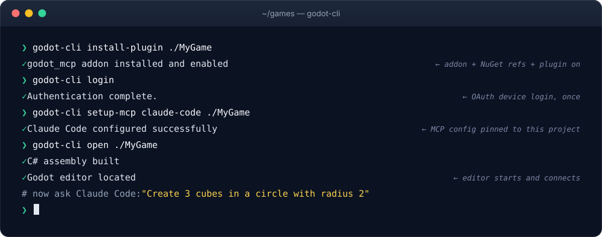

<div align="center">

<p></p>

[](https://github.com/IvanMurzak/Godot-MCP/actions/workflows/ci.yml) [](https://github.com/IvanMurzak/Godot-MCP/releases/latest) [](https://godotengine.org/asset-library/asset/5245) [](https://www.npmjs.com/package/godot-cli) \
[](https://godotengine.org/) [](https://dotnet.microsoft.com/) [](../LICENSE) [](https://discord.gg/cfbdMZX99G) [](https://stand-with-ukraine.pp.ua)

[English](../README.md) · [中文](README.zh-CN.md) · [日本語](README.ja.md) · [Español](README.es.md) · **Português** · [فارسی](README.fa.md) · [हिन्दी](README.hi.md) · [العربية](README.ar.md)

</div>

O **Godot-MCP** conecta agentes de IA (Claude Code, Cursor, Codex, GitHub Copilot, Gemini ou qualquer outro cliente [MCP](https://modelcontextprotocol.io/)) ao **editor Godot**. O agente pode ler e alterar suas cenas, nós, recursos e scripts, compilar e executar C# e ver capturas de tela. É um addon de editor com uma CLI companheira, o [`godot-cli`](../cli/docs/README.pt-BR.md), e o irmão do [Unity-MCP](https://github.com/IvanMurzak/Unity-MCP) para Godot.

**Requisitos:** a **versão .NET** do editor Godot 4.3+ e o **SDK do .NET 8**, instalados uma única vez. Seus scripts podem continuar em GDScript. O `godot-cli`, opcional, precisa do Node.js 22.14+. Funciona no Windows, macOS e Linux.

<a id="why"></a>
## Por que o Godot-MCP

✅ **Godot 4.3 a 4.7** — cada release é testada no CI com 4.3, 4.4, 4.5, 4.6 e 4.7\
✅ **Builds C# de verdade** — `script-build` executa `dotnet build` e devolve os erros do compilador\
✅ **Verificações de GDScript** — `script-validate` devolve diagnósticos de parse e compilação de arquivos `.gd`\
✅ **Edições atômicas e desfazíveis** — as mudanças de uma query aplicam tudo ou nada, um Ctrl+Z para cada\
✅ **Capturas de tela** — viewport, uma câmera ou um nó renderizado isolado, devolvidos ao agente\
✅ **Ferramentas de runtime** — logs, reflexão C# e erros de runtime de um jogo em execução (opt-in)\
✅ **Nuvem gratuita ou totalmente local** — ai-game.dev por padrão (sem portas abertas), ou um servidor local sem conta\
✅ **Sem telemetria** — o addon e o `godot-cli` não enviam dados de uso nem de análise

<a id="gdscript"></a>
## Funciona com projetos GDScript

O código do seu jogo continua em GDScript. O addon em si é C#, então o projeto precisa de alguns passos únicos:

✅ **Editor Godot .NET** — abra o projeto na versão .NET do Godot 4.3+ (mesmo projeto, mesmas cenas)\
✅ **SDK do .NET 8** — instalado uma vez por máquina\
✅ **Solução C#** — projeto existente: **Project → Tools → C# → Create C# solution**; novo: `create-project --dotnet`\
✅ **O addon** — `godot-cli install-plugin` o adiciona, com suas referências NuGet, e o habilita

**Um projeto só com GDScript precisa de uma solução C#?** Sim, uma vez: o addon é C# e compila no assembly C# do projeto. **Create C# solution** adiciona um `.csproj` e um arquivo `.sln` na raiz do projeto. Seus scripts `.gd`, cenas e recursos não são alterados e rodam como antes; o agente também lê, escreve e valida GDScript. As exportações usam então os templates de exportação .NET do Godot e incluem os pequenos assemblies de runtime do addon, que ficam inativos a menos que seu código chame `GodotMcpRuntime.Initialize()` ([como deixá-los de fora](ARCHITECTURE.md#optional-strictly-zero-bytes-export-exclude-for-dev-only-users)).

<p align="center">
  
</p>

<a id="how-it-works"></a>
## Como funciona

<p align="center">
  
</p>

O addon conecta-se a um servidor MCP, e seu agente conecta-se ao mesmo servidor e chama as ferramentas do addon. O servidor é um [GameDev-MCP-Server](https://github.com/IvanMurzak/GameDev-MCP-Server) local que o addon baixa e executa para você, ou o relay hospedado [ai-game.dev](https://ai-game.dev). O addon não abre nenhuma porta própria.

<a id="stability"></a>
### Estabilidade

- **Versionamento:** o addon e o `godot-cli` são sempre publicados com o mesmo número de versão; leia as [notas de release](https://github.com/IvanMurzak/Godot-MCP/releases/latest) antes de atualizar.
- **O que muda entre versões:** uma release pode mover as versões NuGet de que o addon precisa e a versão do GameDev-MCP-Server que ele baixa. `godot-cli update` (ou `install-plugin`) escreve as versões NuGet que correspondem ao addon instalado, e o addon busca sozinho o servidor correspondente.
- **Portão de release:** uma release só é publicada depois que os testes .NET, os testes da CLI e os testes dos editores Godot 4.3–4.7 passam.
- **Histórico de mudanças:** cada [release no GitHub](https://github.com/IvanMurzak/Godot-MCP/releases) lista as mudanças mescladas; o `godot-cli` também mantém um [changelog](../cli/CHANGELOG.md).

<a id="quick-start"></a>
## Início rápido

Instale o `godot-cli` (Node.js 22.14+) e adicione o addon ao seu projeto:

```bash
npm install -g godot-cli
godot-cli install-plugin ./MyGodotProject             # addon + referências NuGet + habilitar o plugin
```

Depois escolha como o agente alcança o editor. As duas são configurações completas. A nuvem é o padrão do addon: sem portas abertas, sem conflitos de porta com outros programas, e gratuita. O local mantém tudo na sua máquina, para trabalho offline ou isolado da rede.

**Opção A: local, sem conta.** As chamadas de ferramenta ficam na sua máquina.

1. **Defina um token.** Abra o projeto no editor Godot .NET. No dock **AI Game Developer** escolha **Custom**, defina **Authorization → token**, pressione **Generate** e depois **Start Server**. Anote a **Server URL** (`http://localhost:<port>`, uma porta derivada do caminho do projeto).
   Ou escolha você mesmo um token, abra o editor com ele a partir de um terminal e pressione **Start Server**:
   `godot-cli open ./MyGodotProject --mode Custom --auth Required --token <token>`
2. **Conecte seu agente** com o mesmo token:

```bash
godot-cli setup-mcp claude-code ./MyGodotProject --url http://localhost:<port> --token <token>
```

> **Sem um token** o servidor local usa autorização `none`. Ele escuta somente no loopback, então apenas programas no seu próprio computador podem alcançá-lo.
> Nesse caso `godot-cli open ./MyGodotProject` inicia o editor e seu servidor local em um passo e imprime a URL para `setup-mcp --url`.

**Opção B: nuvem ai-game.dev.** Faça login uma vez por máquina; as configs dos agentes passam então a carregar uma chave vinculada a este projeto.

```bash
godot-cli login                                       # login OAuth por dispositivo no navegador
godot-cli setup-mcp claude-code ./MyGodotProject      # escrever a config MCP do agente
godot-cli open ./MyGodotProject                       # compilar C#, iniciar o editor, conectar
```

Depois peça ao seu agente: *"Crie 3 cubos em um círculo com raio 2."*

Para instalar pela aba **AssetLib** do editor, por um [zip de release](https://github.com/IvanMurzak/Godot-MCP/releases/latest) ou manualmente, siga [docs/install.md](install.pt-BR.md): o `.csproj` do projeto precisa então das referências NuGet do addon (`com.IvanMurzak.ReflectorNet`, `com.IvanMurzak.McpPlugin`, e os pacotes somente de editor `com.IvanMurzak.Rql`, `com.IvanMurzak.CodeExec`, `com.IvanMurzak.CodeExec.Roslyn` e `Microsoft.CodeAnalysis.CSharp`) nas versões da release que você instalar.

<a id="relay"></a>
### O que passa pelo ai-game.dev

Somente no modo Cloud. O relay é sem estado (stateless): ele roteia chamadas de ferramenta entre seu agente e o editor sem inspecionar nem persistir seus conteúdos, e não coleta suas conversas, código-fonte, arquivos do projeto, assets nem dados de cena. Ele registra metadados de requisição (endereço IP, hora e duração, código de status HTTP e caminho da requisição, nome da ferramenta e contagem de chamadas, tamanho da requisição e da resposta, endpoint e tipo de cliente) e metadados de eventos MCP (tipo do evento, tempos, status, identificadores de sessão, o nome da ferramenta, do prompt ou do recurso, e detalhes de erro). Esses registros são usados principalmente dentro de uma janela móvel de 90 dias; a política não promete exclusão em um prazo fixo. Detalhes: [Política de Privacidade](https://ai-game.dev/legal/privacy). No modo local, o editor e o servidor falam apenas via localhost.

<a id="clients"></a>
## Conecte seu cliente de IA

`godot-cli setup-mcp <agent> ./MyGodotProject` escreve a config para você (`godot-cli setup-mcp --list` mostra todos os ids de agente). A entrada do servidor chama-se `ai-game-developer`; `<url>` é a URL que o `setup-mcp` imprime. No modo Cloud a entrada também carrega `Authorization: Bearer agd_pk_…`, uma chave que alcança somente este projeto.

<details>
<summary><b>Claude Code</b> — <code>.mcp.json</code> no projeto</summary>

```bash
godot-cli setup-mcp claude-code ./MyGodotProject
```

```json
{ "mcpServers": { "ai-game-developer": { "type": "http", "url": "<url>" } } }
```
</details>

<details>
<summary><b>Cursor</b> — <code>.cursor/mcp.json</code></summary>

```bash
godot-cli setup-mcp cursor ./MyGodotProject
```

```json
{ "mcpServers": { "ai-game-developer": { "type": "http", "url": "<url>" } } }
```
</details>

<details>
<summary><b>VS Code (Copilot)</b> — <code>.vscode/mcp.json</code></summary>

```bash
godot-cli setup-mcp vscode-copilot ./MyGodotProject
```

```json
{ "servers": { "ai-game-developer": { "type": "http", "url": "<url>" } } }
```
</details>

<details>
<summary><b>Codex</b> — <code>.codex/config.toml</code></summary>

```bash
godot-cli setup-mcp codex ./MyGodotProject
```

```toml
[mcp_servers.ai-game-developer]
enabled = true
url = "<url>"
tool_timeout_sec = 300
startup_timeout_sec = 30
```

No modo Cloud a chave vai em `http_headers`.
</details>

<details>
<summary><b>Gemini CLI</b> — <code>.gemini/settings.json</code></summary>

```bash
godot-cli setup-mcp gemini ./MyGodotProject
```

```json
{ "mcpServers": { "ai-game-developer": { "type": "http", "url": "<url>" } } }
```
</details>

Também suportados: Claude Desktop, Visual Studio (Copilot), GitHub Copilot CLI, Rider (Junie), Antigravity, Cline, Open Code, Kilo Code e um cliente genérico `custom` ([referência da CLI](../cli/docs/README.pt-BR.md#supported-ai-agents)).

<a id="what-the-agent-can-do"></a>
## O que o agente pode fazer

**Cobertura:** o agente pode fazer praticamente tudo o que você faz no editor Godot: cenas, nós, recursos, configurações do projeto, scripts, builds C#, capturas de tela e um jogo em execução.\
**Eficiência:** as ferramentas são compactas, então o agente precisa de menos chamadas e menos tokens e trabalha mais rápido e mais barato. Isso é medido em testes: na [avaliação de agentes do RQL](https://github.com/IvanMurzak/RQL/blob/main/RESULTS.md) em um mundo de jogo sandbox, uma tarefa levou 2–3 chamadas de ferramenta e cerca de 8 mil tokens com RQL, contra cerca de 37 chamadas e 169 mil tokens com ferramentas convencionais de reflexão find / get / set.

Você não escreve queries: o agente lê o guia de RQL que acompanha as ferramentas (`rql-schema`, a skill `godot-rql`) e as escreve sozinho.

| Capacidade | Ferramentas | Peça ao seu agente |
| --- | --- | --- |
| Cenas e nós | `rql-query`, `rql-mutate` | *"Adicione uma DirectionalLight3D à cena principal e salve-a."* |
| Edições em massa | `rql-mutate` | *"Oculte todo nó cujo nome começa com Enemy."* |
| Recursos e configurações do projeto | `rql-query`, `rql-mutate` | *"Adicione uma ação de input jump vinculada a Espaço."* |
| Consultar a API | `rql-schema` | *"Quais propriedades Godot um CharacterBody3D tem?"* |
| Scripts (GDScript e C#) | `script-create`, `script-update`, `script-attach-to-node`, `script-validate`, `script-read`, `script-delete` | *"Escreva um GDScript que rotaciona este nó e anexe-o."* |
| Compilar C# | `script-build` | *"Compile o projeto C# e corrija os erros."* |
| Executar C# no editor | `script-execute` | *"Conte os nós MeshInstance3D na cena aberta."* |
| Ver o resultado | `screenshot-viewport`, `screenshot-camera`, `screenshot-isolated` | *"Tire uma captura do viewport e verifique a iluminação."* |
| Jogo em execução (opt-in) | `console-*`, `reflection-*`, `runtime-errors-*` | *"Verifique novos erros de runtime no jogo em execução."* |

`ping`, `session-close`, `godot-skill-create` e `godot-skill-generate` são ferramentas de sistema para o `godot-cli` e para configuração; os agentes não as veem. Todas as ferramentas e argumentos: [docs/tools.md](tools.pt-BR.md).

As mesmas ferramentas funcionam de um terminal, na pasta do projeto (um editor headless inicia quando nenhum está rodando):

```bash
godot-cli rql 'nodes | where name starts-with "Enemy" | set Visible = false'
godot-cli exec '1 + 2'        # → System.Int32: 3
godot-cli tools               # listar as ferramentas do editor
```

<a id="security"></a>
## Segurança

| Área | O que se aplica |
| --- | --- |
| **Servidor local** | Escuta somente no loopback. Sua autorização padrão é `none`, então qualquer processo na sua máquina pode chamá-lo. Escolha `token` no dock, defina `GODOT_MCP_TOKEN`, ou abra o editor com `godot-cli open <path> --mode Custom --auth Required --token <token>` para exigir um token bearer. |
| **Verificações de Origin** | O servidor responde `403` a uma requisição com um header `Origin` não permitido, em todos os modos de autorização (defesa contra DNS rebinding). |
| **Addon do editor** | Não abre porta; conecta-se ao servidor. Uma ponte de controle somente para desenvolvimento em `127.0.0.1` só inicia com `GODOT_MCP_DEV_CONTROL=1`. |
| **Nuvem** | As configs dos agentes carregam uma chave vinculada a um projeto; o editor usa o login da sua máquina. Seu token de conta vai apenas ao ai-game.dev ou a um servidor em localhost. O relay é sem estado: não inspeciona nem persiste o conteúdo das chamadas de ferramenta ([Política de Privacidade](https://ai-game.dev/legal/privacy)). |
| **Tokens armazenados** | O editor salva seu token como JSON puro em `user://godot-mcp-config.json`; trate esse arquivo como um segredo. |
| **Jogos exportados** | Nada roda em um jogo a menos que seu código chame `GodotMcpRuntime.Initialize(...)` e `Connect()`, apenas com as ferramentas que você registrar. Captura de erros e C# no jogo são opt-ins separados ([segurança de runtime](runtime-security.pt-BR.md)). |
| **Não protegido** | Chamadas de ferramenta alteram seu projeto e executam C# no editor: use controle de versão e nunca exponha um servidor com autorização `none` a uma rede. |

Detalhes: [Conexão e servidor](connection.pt-BR.md) e [README do GameDev-MCP-Server](https://github.com/IvanMurzak/GameDev-MCP-Server#readme).

<a id="extensions"></a>
## Extensões

Extensões são pacotes NuGet opcionais que estendem o RQL; elas não adicionam ferramentas próprias.

```bash
godot-cli install-extension com.IvanMurzak.Godot.MCP.CSG ./MyGodotProject
```

| Extensão | Adiciona | Requer |
| --- | --- | --- |
| [Animation](../extensions/Godot-AI-Animation/README.md) | Bibliotecas de AnimationPlayer, trilhas e chaves | |
| [Beehave](../extensions/Godot-AI-Beehave/README.md) | Árvores de comportamento e seus nós | Addon [Beehave](https://github.com/bitbrain/beehave) |
| [CSG](../extensions/Godot-AI-CSG/README.md) | Formas CSG com dimensões validadas | |
| [Dialogic](../extensions/Godot-AI-Dialogic/README.md) | Timelines e personagens | Addon [Dialogic](https://github.com/dialogic-godot/dialogic), Godot 4.4+ |
| [GridMap](../extensions/Godot-AI-GridMap/README.md) | Configurações de GridMap, linhas de células e edição de células | |
| [Navigation](../extensions/Godot-AI-Navigation/README.md) | Agentes de navegação, regiões, links, baking | |
| [Particles](../extensions/Godot-AI-Particles/README.md) | Partículas GPU em 2D e 3D | |
| [PhantomCamera](../extensions/Godot-AI-PhantomCamera/README.md) | Câmeras virtuais, follow e look-at | Addon [Phantom Camera](https://github.com/ramokz/phantom-camera), Godot 4.4+ |
| [Terrain3D](../extensions/Godot-AI-Terrain3D/README.md) | Fonte de terreno, tamanho de região e materiais | Addon [Terrain3D](https://github.com/TokisanGames/Terrain3D), Godot 4.4+ |
| [Tilemap](../extensions/Godot-AI-Tilemap/README.md) | Linhas de células de TileMapLayer e edição de células | |

Instale você mesmo no projeto o addon de terceiros exigido; a seção **Extensions** do dock pode instalar todos.

<a id="documentation"></a>
## Documentação

| Página | O que contém |
| --- | --- |
| [Instalação manual](install.pt-BR.md) | AssetLib, zip de release, referências NuGet, configuração do agente |
| [Conexão e servidor](connection.pt-BR.md) | Modos Cloud e Custom, variáveis, o servidor |
| [Referência de ferramentas](tools.pt-BR.md) | Cada ferramenta e seus argumentos, capturas de tela, extensões |
| [RQL no Godot-MCP](rql.md) | Fontes, funções, escritas, undo e salvamento |
| [Ferramentas personalizadas](custom-tools.pt-BR.md) | Escrever ferramentas, reloads de assembly C#, o problema conhecido do .NET 10 |
| [Uso em runtime](runtime.pt-BR.md) | MCP dentro de um jogo em execução: configuração, captura de erros, C# no jogo |
| [Segurança de runtime](runtime-security.pt-BR.md) | O que o runtime no jogo garante e o que você deve fazer |
| [Referência da CLI](../cli/docs/README.pt-BR.md) | Cada comando do `godot-cli`, códigos de saída e formatos de saída |
| [Arquitetura](ARCHITECTURE.md) · [Releases](RELEASING.md) · [Extensões](EXTENSION-MONOREPO.md) | Para contribuidores |

<a id="contributing"></a>
## Contribuindo

Nenhum binário do Godot é necessário para compilar e rodar os testes unitários:

```bash
dotnet restore Godot-MCP.sln
dotnet build  Godot-MCP.sln --configuration Debug --no-restore
dotnet test   Godot-MCP.Tests/Godot-MCP.Tests.csproj --configuration Debug --no-build
```

As convenções, o teste de fumaça do editor headless e as principais armadilhas estão em [AGENTS.md](../AGENTS.md). Faça um fork do repositório e abra um pull request contra `main`. Dúvidas e demonstrações: [Discord](https://discord.gg/cfbdMZX99G).

Relacionados: [GameDev-MCP-Server](https://github.com/IvanMurzak/GameDev-MCP-Server) · [Unity-MCP](https://github.com/IvanMurzak/Unity-MCP) · [RQL](https://github.com/IvanMurzak/RQL) · [Code-Exec](https://github.com/IvanMurzak/Code-Exec) · [ai-game.dev](https://ai-game.dev)

<a id="license"></a>
## Licença

**Desenvolvedores de jogos podem usar tudo livremente, incluindo jogos comerciais.** O Godot-MCP é [Apache-2.0](../LICENSE). Suas dependências do lado do editor, RQL e Code-Exec, usam a [PolyForm Shield License 1.0.0](https://polyformproject.org/licenses/shield/1.0.0/), que restringe apenas empresas que constroem ferramentas de IA concorrentes para desenvolvimento de jogos.
